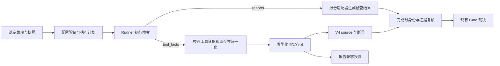

# 可扩展工具事实与规则断言设计

**设计版本 v0.3 · 2026-11-18**

实现基线为 `4d8537e24138c1fc4b2dcbfd3d21682fc0191fad`。开发构建已跑通项目自建工具、类型化事实生产和 V4 裁决。通用克隆对生产者仍有一项已复现的协议校验缺口。行为要求见 [TFA-01 至 TFA-08](../requirements/tool-facts-and-assertions.md)。

## 1. 设计范围与已有基础

项目约束能用已有事实表达时，可以直接编写有来源绑定的规则。缺少检测能力时，Agent 可以在被检项目的 `tools/<name>/` 编写 Rust 检查器，再由项目策略显式接入。目录名由项目约定，执行入口由 `checks[].argv` 指定。`checks[].tools` 运行版本探针，可用 `inputs` 绑定源码、manifest 和锁文件。两条输出路径共用快照、runner、依赖计划和最终 Gate。

| 工具提供的结果 | 策略接入 | 谁判定违规 |
| --- | --- | --- |
| 已定位的诊断、测试结果或覆盖率报告 | 在命令的 `reports` 中声明 diagnostics、SARIF、JUnit 等受支持格式和读取位置 | 命令检查结合退出状态及报告内容作出裁决。自建工具退出 0 仍可因有效违规诊断得到 fail。 |
| 可被多条规则复用的函数指标或克隆对 | 在策略命令中声明一个 `tool_facts` 输出及与 `tool_id` 同名的版本探针。该命令的 `reports` 和 `projects` 须为空 | producer 负责采集和验证。V4 规则在 `depends_on` 中列出 producer，在 `fact_sources` 选择其输出，再独立判断阈值或关系。 |

在已支持的事实形状内，项目可以增加指标和消费规则。新增实体、字段类型或关系形状涉及版本化契约、独立库存、适配器和求值器。工具配置、可用字段和已实测接入示例分别见[工具报告参考](../../docs/en/02-reference/03-projects-and-tool-reports.md)、[V4 参考](../../skills/qualitygate-cli/references/operators-v4.md)与[项目工具实测](rule-engine-and-tool-builders.md#agent-自建工具的两条实测路径)。

## 2. 能力归属与依赖方向

沿用[开发视图](../../docs/en/03-architecture/03-development-view.md)的 capability contract。
实现放在 `src/qualitygate` 下直接命名的业务 concern；不在兼容 facade 下新增实现层。
`tool_evidence` 与 `tool_bridge` 是业务 concern；一个 concern 内的具体模块按其实际能力登记。

| Owner | 实现职责 | 禁止承担的职责 |
| --- | --- | --- |
| `domain` | 工具事实、类型及版本描述，纯数值比较、完整性判断与规则结果契约 | 文件读取、进程句柄、AST 缓存、CLI 参数 |
| `config` | 工具输出声明、V4 source 与字段验证，依赖及执行计划编译 | 调用工具、推测实际采集完成 |
| `snapshot` | 复用选定快照、物化输入、源路径与内容身份验证 | 解释工具指标或业务阈值 |
| `adapters` | 有界解析、格式归一化、能力描述及原始结果语义映射 | 改写项目策略或代替 Gate 决定交付 |
| `runner` | 外部工具的命令、超时、输出及取消边界 | 将任意非零退出解释成已发现缺陷 |
| `application` | 生产者执行、事实存储、依赖消费、完成时复核与聚合 | 解析上游 EDN 格式或逐工具重写阈值规则 |
| `interfaces` | 桥接入口、帮助、Schema/能力展示和输出渲染 | 直接访问文件或执行子进程 |
| `env` / `paths` / `net` | 继续拥有各自既定的外部能力 | 为适配器提供无边界的环境、路径或下载访问 |

纯事实模块进入 reviewed owner map 和 Miri inventory；适配器继续不能依赖 CLI。
公共历史 facade 保持兼容。新的归一化代码以 Rust 库提供，CLI 接入程序调用相同实现。
domain 定义封闭的 `FactSchema` 与 `ToolFormat`。adapters 在 `normalize` 中按格式分派到 crapper、dryer 或通用 JSON 导入器。两个入口共享这段实现。[事实类型](../../src/qualitygate/tool_evidence/contracts.rs) · [归一化分派](../../src/qualitygate/tool_evidence/normalization.rs)

## 3. 运行数据流



### 3.1 计划与执行结果

`Plan` 保存规则设置、命令配置、执行顺序与必需检查清单。分派前通过 `Plan::operation` 取出 `PlannedOperation`，区分规则、命令、手工验收、兼容验证和成对测试。事实采集沿用普通命令的执行路径、依赖和超时。[执行计划](../../src/qualitygate/check_planning/plan.rs)

内部结果为 `ExecutionOutcome { check_result, evidence }`，类型化 `evidence` 分别持有项目事实、
工具事实、已验证覆盖率及真实执行凭据。
`check_result` 继续满足现有执行状态与裁决模型，工具事实是经校验的类型化集合。
采集失败时可保留原始产物和部分解析证据用于诊断，但不能发布可被成功断言消费的完整集合。
普通 lint command 继续按现有诊断与退出码规则裁决；事实生产者必须显式声明自己的输出契约。

应用层按生产者节点保存结果，只将已声明依赖且满足采集契约的集合提供给消费者。
同一运行内，一个生产者的相同范围输出可以被多个 source 引用；不因规则数增加而重复执行工具。
首期不引入跨运行事实缓存，也不因本次拆分增加共享 workspace 上的并发命令。

### 3.2 身份与完整性

`ToolFacts` 信封由统一协议版本、输出契约、采集范围、记录及证据引用组成。
采集范围包括声明的项目/target inventory、配置身份、采集筛选条件和确认完成的范围。
记录类型、数值约定及空集合条件由 TFA-02、TFA-03、TFA-05 定义。

工具提交的 snapshot/producer 字段是待校验声明。通用生产者可从 `context_path` 读取本次执行身份，再通过 stdout 或声明的产物文件返回报告。应用层绑定选定快照、实际命令、工具探针和保留产物摘要。离线桥接程序接受原始报告与上下文文件，输出始终标记为 `complete: false`。[采集实现](../../src/qualitygate/gate_execution/fact_execution.rs) · [桥接回归](../../tests/tool_bridge.rs)

事实 v1 从声明的 Rust 文件独立枚举受支持的函数项，排除闭包、直接声明在块内的函数及内联 `mod tests` 中的函数。指标记录须覆盖每个入选位置与每个声明指标。克隆对在相似度和节点下限均为零时可以按长度入选的函数数核对总对数。存在采集过滤时，核对两端位置仍可能漏掉合格的对。项目检查器需有独立的已知值和漏报样例来验证测量方法。[库存实现](../../src/qualitygate/tool_evidence/inventory.rs) · [记录校验](../../src/qualitygate/tool_evidence/normalization.rs)

完成时仍执行现有输入、策略及外部证据复核，再计算约束覆盖和最终 Gate。
失效的生产者事实及依赖其产生的断言结果不能保留可接受结论；报告保留失效原因和原始运行记录。
既有报告 metadata 的兼容输出不再是内部事实权威，消费端不反向解析展示 JSON 获取事实。

## 4. 接口与版本策略

### 4.1 工具输出与规则 source

接口分为三个层次，版本各自显式记录，不将上游工具版本当成协议版本：

| 接口 | 提供方与消费者 | 首期内容 |
| --- | --- | --- |
| 工具事实协议 v1 | 适配器/桥接程序 → Qualitygate | 函数指标和重复代码对，采集范围、完整性及证据引用 |
| 项目规则 schema v4 | 策略作者 → config 与规则引擎 | 源码或工具事实 source、类型化字段、既有有限组合算子 |
| 运行能力声明 | CLI → 策略验证及调用方 | `rules.operators.v4`、事实 schema 和适配器支持范围 |

工具 source 的逻辑接口是“生产者 check ID + 输出/事实 schema + 项目与 target 选择条件”。
config 在执行前验证生产者存在、依赖显式声明、输出兼容及字段类型；未知字段或单位不匹配
属于规则无效，运行中缺少契约要求的字段属于证据未完成。两种错误均不能变成普通断言为 false。

例如，行数夹具在策略中为规则声明 `depends_on: [scan]`。以下是其 V4 规则文件里选择指标与判定阈值的两个字段。先要求至少一条记录，可避免完整空集满足全称断言。

```yaml
fact_sources:
  spans: {producer: scan, schema: function_metric, schema_version: 1, project: app, metric: span_lines, unit: count, measurement: inclusive-function-lines-v1}
assertion:
  op: and
  args:
    - {op: compare, left: {op: count, input: {op: source, name: spans}}, relation: ge, right: {op: number, value: 1}}
    - op: all
      input: {op: source, name: spans}
      predicate: {op: compare, left: {op: field, name: value}, relation: le, right: {op: number, value: 3}}
```

指标名称与测量定义分离：采用相同已注册事实类型的新工具可以提供新指标名称，规则明确选择
该名称、单位和测量定义；不需要让 Gate 增加工具 ID 分支。新的事实结构需要显式版本和
能力声明，不能由任意上游字段自动成为表达式可访问属性。

### 4.2 兼容与错误边界

V1–V3 的已发布 schema、算子、内容摘要和回放解释保持不变。V4 复用词法作用域、集合算子
与工作量控制的实现，但不让旧规则自动获得新字段或改变比较结果。
完整报告及 decision envelope 沿用既有协议；新增事实证据通过兼容的元数据/产物引用投影。
独立工具事实协议有自己的版本，不能直接替换现有 diagnostics 输入格式。

接入前以实际可执行文件的 `capabilities --format json` 核对 `rules.operators.v4` 与 `tool-facts.v1`。本次核对的开发 CLI 与已安装 Skill CLI 均显示 1.3.0。开发构建支持两项能力，已安装构建可运行普通 diagnostics 检查，对该 V4 规则执行 `rules validate` 则拒绝其版本。[兼容性记录](../requirements/tool-facts-and-assertions.md#v1v4-兼容性实测)
有界十进制的编码、规范化、单位和比较规则以 TFA-02 为准；这里不再定义第二套转换算法。
原始指标若经过上游舍入，协议保留其测量定义，不以精确序列化比较宣称恢复了上游数学精度。
固定版本 dryer 在输出 12 位小数之前筛选原始相似度，因此 V4 source 的范围验证还检查
舍入前的最小原始值：对消费下限向上取最近的 12 位十进制格点 `q`，要求采集下限为零，
或不大于 `q - 0.0000000000005`。该计算在有界整数中精确执行，并同时用于规划与消费阶段。
这是采集完整性的保守条件；实际记录与策略阈值仍按 TFA-02 精确比较。
边界反例及固定版本证据见[原生工具验证记录](../test/tool-facts-native-validation.md)。

报告解析的字节、深度、记录数与时间预算和表达式的 source、集合、节点及工作量预算分别计账。
复用集合不能绕过各消费者实际遍历的预算；截断报告不能充当完整集合参与断言。

### 4.3 通用克隆对下限的已知差异

公开的工具事实 Schema 要求 `minimum_lines >= 1`。当前通用 `clone_pair` 生产者允许配置与信封同时取 0，并可发布 `complete: true` 的产物。仅运行生产者时 Gate 退出 0。加入必需 V4 消费者后，消费端以 `Invalid acquired clone universe` 阻断，Gate 退出 2。相同夹具取 1 时，产物符合 Schema，生产者与消费者均通过。

待修正的位置是通用生产者的输出声明及归一化校验。修复验收须确认零值在发布完整事实前被拒、没有消费者也不能使必需生产者通过，同时保留取 1 的正例，并以导出的 Schema 校验实际保留的产物。[复现记录与实现位置](rule-engine-and-tool-builders.md#已复现的契约差异)

## 5. 首批适配与独立验证

首期适配 crapper 与 dryer；工具、依赖、parser 摘要和实际正反例见
[原生工具验证记录](../test/tool-facts-native-validation.md)。原生执行支持 Linux x86_64，
固定 language-pack 1.25.2 和已验证的 Rust parser，使用私有缓存与无效本地 manifest 禁止下载。
其他平台仍可使用离线归一化和桥接程序；未覆盖的原生执行形态明确返回不支持。
上游项目仍为外部工具；本仓库只维护 Rust 解析、归一化、协议及独立验证逻辑。
工具安装和依赖准备是显式环境步骤，不由报告解析或 Gate 执行时隐式下载。

| 适配路径 | 对应需求 | 实现设计 |
| --- | --- | --- |
| crapper 函数指标 | TFA-02、TFA-03、TFA-06 | 先用已有执行边界产生并验证覆盖率，将已验证产物提供给上游的已有覆盖率模式，再归一化函数指标；字段缺失和未覆盖分别处理 |
| dryer 重复代码对 | TFA-05、TFA-06 | 保留双侧位置、候选范围、相似度及采集过滤条件；由策略断言阈值，解析警告或未完成范围保留为执行缺口 |
| mutator 结果 | TFA-07，后续 | 未分类 killed 只能作为有来源的建议性观察；增加独立逐变异执行证据前，不接入严格 test-effectiveness 阻断 |
| 模型检查结果 | TFA-07，后续 | 后续协议保留模型、配置、检查边界和反例产物，unknown 不变成布尔断言结果 |
| uml-viewer | TFA-07，后续 | 消费结构与指标证据；现有架构 gate 继续裁决依赖约束，首期不集成 GUI 或伴随 Agent |

固定版本原生夹具中，crapper 采到六条指标，dryer 采到一对克隆。缺少解析器或依赖版本不符时，相关生产者均报 `tool_error`。这组实测覆盖采集与离线转换。V4 阈值和依赖传播由独立的通用生产者夹具验证。正式阻断所需的检出率、误报率与延迟仍须在目标项目中测量。[原生执行结果](../test/tool-facts-native-validation.md#observed-outcomes) · [V4 工作流回归](../../src/qualitygate/gate_execution/fact_workflow_tests.rs)

## 6. Bazel 构建与独立入口

对应 TFA-08，首期保留根 Cargo package 和 Cargo.lock，通过显式第二个 `[[bin]]`
提供 `qualitygate-tool-bridge`。根 package 设置 `default-run = "qualitygate"`，保留现有
`cargo run -- ...` 与 `//:qualitygate` 的使用方式。该名称已在开发构建中注册；现有二进制发行包不会自动包含它。

桥接程序提供有界“原始工具报告 → 工具事实协议”的转换入口，不隐式运行工具或安装依赖。
接口解析属于 interfaces；文件访问与工作协调通过既有能力边界；格式处理属于 adapters。
Qualitygate 本身可直接调用同一归一化库，不需要再启动一个桥接子进程。
独立入口可供其他调用方使用；离线输出始终为 `complete: false`，不能冒充第 3 节的真实运行绑定。

Bazel 为纯契约、归一化库、桥接 binary 和测试声明明确 targets、visibility 和实际外部依赖。
不把所有 CLI 依赖无差别传给每个新增 target；不同工具格式不各自复制调度或协议库。
上游 Python 工具作为固定版本的运行依赖另行准备，构建桥接 binary 不会证明这些工具已运行。

架构扫描已从原来的 CLI lib/main 扩展到 reviewed production target inventory，
并检查未登记入口和源码不可达的反例。业务模块归属、domain I/O 限制、
文档行数、Miri 纯模块清单及 Cargo/Bazel 测试覆盖均随入口清单检查。
CI 与仓库策略使用同一组全产品构建和测试目标，保持单元与集成测试独立。
`cargo package` 包含两个 binary target，从源码执行 `cargo install --path . --locked --bins` 安装两者，
指定 `--bin qualitygate` 则只安装主 CLI。Bazel 的 `//:production_binaries` 构建两者，
`//:qualitygate-tool-bridge` 可单独构建桥接入口。当前 GitHub release 与 Skill 归档的打包清单只收录主 CLI。
[双入口构建、安装及打包合同](../../docs/en/04-contributor-guide/01-development-and-quality-gates.md#independent-tool-bridge)

## 7. 实现验收与后续边界

项目自建检查器已在隔离 Git 仓库走通两条路径。诊断工具定位了第二行违规，输入文件缺失时返回 incomplete。
另一个工具报告函数行数，以 3 行为上限时，3 行和 4 行输入均成功发布事实，消费规则分别通过和失败。
输入超出工具支持形态时，生产者未发布事实，必需消费者被阻断。夹具的完整策略、来源绑定和逐项结果见[自建工具实测](rule-engine-and-tool-builders.md#agent-自建工具的两条实测路径)。

当前仓库策略的 full profile 选用 `line-ending` 和十个命令检查，配置的 `tool_facts` 生产者为零。
因此，生产者和 V4 的接入证据来自上述隔离夹具，生产项目采用及其效果仍待验证。
按条款查找单元测试、执行集成和已验证范围，见[需求验收矩阵](../requirements/tool-facts-and-assertions.md#验收矩阵)与[仓库策略](../../qualitygate.yaml)。
