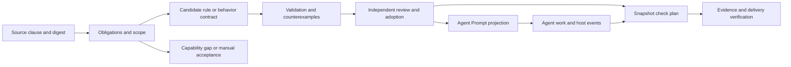
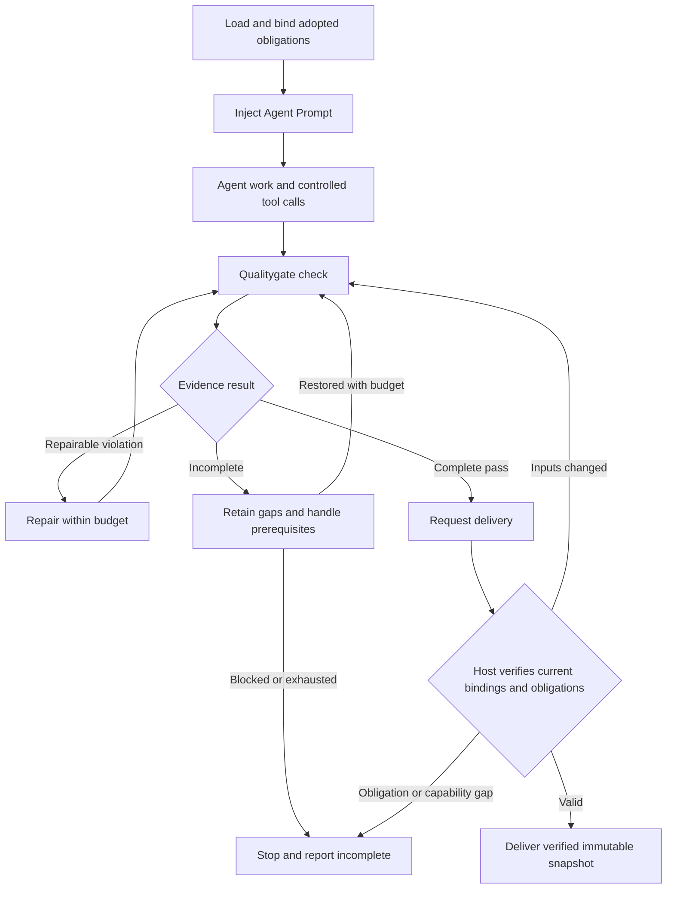

# Five rule capabilities and Agent behavior contracts

[简体中文](../../zh/03-architecture/07-rule-capabilities-and-agent-contracts.md) · [Volume index](README.md) · [Rule engine implementation](06-rule-engine-implementation.md)

Status: staged implementation of the design based on version `0.5.7`.
[Clause coverage](../02-reference/07-constraint-coverage.md) is implemented with
capability `constraints.coverage.v1`; [bounded operators](../02-reference/08-bounded-operators.md)
are available as `rules.operators.v2`. [Agent obligation projection](../02-reference/09-agent-contracts.md)
is available as `agent.contracts.v1`; host enforcement remains the next stage. This chapter defines collaboration
boundaries; it does not enable rules. Its readers are
rule maintainers, CLI/core developers, and developers of Agent hosts integrating
Qualitygate.

## 1. Goals and capability model

Natural-language constraints should become traceable, verifiable quality rules
that apply both to artifacts and to the Agent producing them. The fifth family,
“strong constraint Prompt,” governs the consuming Agent's workflow and completion
conditions. Model-assisted review is a separate capability.

Retain five product capabilities, allowing one obligation to combine them:

| Capability | Subject and evaluation | Example obligation | Evidence boundary |
| --- | --- | --- | --- |
| Regex rules | Match patterns in explicitly scoped text | Added source lines must not contain a marker | A match proves a text signal, not a call, type, or data-flow property. |
| AST structure and semantic-fact rules | Select parsed entities; consume project/compiler facts when needed | Added tests follow naming conventions; modules avoid forbidden dependencies | AST proves structure; resolved dependencies, types, and data flow need their respective producers. |
| Lambda operator rules | Apply bounded predicates, collection operations, and aggregation to typed facts | Every added test has a requirement marker and at least one test is added | Operators compose existing facts; they do not create missing semantic knowledge. |
| External-tool rules | Run existing tools and normalize their reports | Lint, coverage, compatibility, and architecture dependency checks | Require producer completion, original reports, and adapter support; a successful process exit does not establish report completeness. |
| Strong constraint Prompt | Deliver behavior obligations to the Agent, connected to evidence verification and host action controls | Recheck repairs; do not deliver before final full verification | Instruction compliance depends on the Agent; runtime enforcement depends on host-controlled entry points. |

These are not five mutually exclusive engines. A test naming rule selects tests
with AST, checks names with regex, and could use `all` to compose assertions.
“Check before delivery” directs the Agent through Prompt, obtains evidence from
external commands, and has the host verify delivery conditions.

Keep three internal dimensions separate: fact source (text, AST,
project/compiler, reports), expression (patterns, assertions, operators,
behavior obligations), and execution/decision owner (deterministic evaluator,
Agent, host, human). Reuse snapshots, diagnostics, reports, and pure gate
decisions without confusing fact precision with rule syntax.

## 2. Existing capabilities and gaps

| Area | Existing implementation | Proposed addition or external responsibility |
| --- | --- | --- |
| Text rules | `source-pattern`, `file-pattern`, name/text assertions, explicit incremental scope and budgets | Add rules for concrete needs without relabelling text matches as semantic proof. |
| Structure and project facts | Tree-sitter entities and base/head matching; bounded facts from project adapters including Maven/Python | New type, call, or data-flow requirements need corresponding capabilities; do not claim complete cross-language semantics. |
| Composable rules | Fixed v1 `when`/`then` assertions and typed v2 expressions over selected entities | Additional semantic predicates need corresponding facts; no open lambda runtime is provided. |
| External tools | Command checks, runner, report normalization, ratchets for supported formats | Unsupported reports need explicit adapters; producers cannot rewrite the gate. |
| Agent instructions | Packaged Skill requires final checks, repair/recheck, honest incomplete results, and authority boundaries | Individually traceable obligations, versioned Prompt projections, and a host integration contract. |
| Repair and delivery | Feedback/recheck, task contracts, and an optional example harness | Generic tool/completion interception belongs to the integrating host; the example is not universal Agent enforcement. |

Current implementation anchors:

- [DSL types](../../../src/qualitygate/config/model.rs) and the [custom evaluator](../../../src/qualitygate/adapters/custom_rules.rs).
- [Fact dependencies and rule execution](../../../src/qualitygate/application/rule_execution.rs) and the [rule engine description](06-rule-engine-implementation.md).
- [Packaged Skill](../../../skills/qualitygate-cli/SKILL.md), [Agent repair workflow](../01-user-guide/04-agent-repair-and-acceptance.md), and [example harness](../../../examples/agent_loop.rs).
- [External judgment](../../../src/qualitygate/application/judgment.rs) only provides shadow/advisory assessment of warnings and cannot change the original gate. It does not implement the fifth capability in this design.

## 3. Translating and covering natural-language constraints

Track each clause by source document, section and digest, obligation identity,
scope, interpretation, required facts, rule/check associations, adoption state,
and positive, negative, and boundary examples. One clause can require several
checks; several clauses can share a producer. The first implementation uses a
separate policy `constraints` inventory; project-rule v1 stays unchanged.



The translation sequence is:

1. Bind the exact normative source. Existing project rules use CLI
   `rules source` and `rules schema`.
2. Separate artifact properties, execution duties, and subjective judgments.
   Preserve exceptions, scope, and requiredness without strengthening or
   weakening the clause on the Agent's initiative.
3. Choose facts and execution that support the conclusion. Reuse existing
   semantic tools; retain explicit gaps for requirements that cannot be expressed.
4. Validate shape, source, capabilities, and budgets, then check meaning with
   positive and negative examples. Schema validity does not prove faithful translation.
5. Execute only after independent policy adoption. Generation, an Agent's
   acknowledgement, or a new digest is not approval.
6. Link results back to clauses, distinguishing unmapped, awaiting review,
   adopted, awaiting verification, violated, and capability gaps.

Source changes require review of affected clauses. Rule, policy, task, or scope
changes require a new plan and verification. Candidate coverage and execution
pass rates remain separate; the percentage of generated rules cannot prove full
normative coverage. Clauses that cannot be machine-verified remain instructions
or explicit manual acceptance obligations, without fabricated passing evidence.

## 4. Bounded lambda operators

Implemented v2 expressions are interpreted typed data. A lambda binds only the current
collection element. It cannot execute arbitrary Rust/scripts, dynamically load
code, recurse, access files/network/processes, or read the environment.
Natural language becomes a candidate during authoring; deterministic execution
does not interpret prose on demand.

| Initial operator | Meaning |
| --- | --- |
| `and`, `or`, `not` | Compose Boolean predicates. |
| `filter` | Select matching elements from a complete, explicitly typed collection. |
| `all`, `any` | Require every element or at least one element to satisfy a predicate. |
| `count`, comparisons | Count selected elements and compare with same-typed constants. |
| Membership, pattern matching | Check membership or a validated regex on declared types. |
| Typed fact predicates | Name/text/path fields use existing selection; marker/dependency assertions remain fixed and additive. |

This is conceptual notation, not syntax accepted by the current CLI:

```text
added_tests = filter(tests, t => t.change == "added")
and(
  count(added_tests) >= 1,
  all(added_tests, t => matches(t.name, naming_pattern)
                       and has_marker(t, "requirement"))
)
```

Static validation rejects unknown fields, operators, variables, type mismatches,
and unsupported fact capabilities. Initial collection inputs are limited to
existing verifiable files, commits, and canonical syntax entities. Declared
producers supply required marker/dependency facts. `join`, `group_by`, arbitrary
graph traversal, and new semantic analyses are outside the initial scope.

Distinguish complete empty collections from incomplete collections. On a
complete empty collection, `all` is true, `any` is false, and `count` is zero;
existence is an explicit count requirement. Missing capabilities or collection
completeness leave the check incomplete rather than empty. Validate all required
facts declared by the rule before evaluation; Boolean short-circuiting cannot
bypass that validation. Missing runtime values, timeouts, and exhausted budgets
cannot become passes through negation or defaults. Preserve already discovered
violations alongside incomplete execution reasons.

Bound expression nodes, nesting, selected elements, text bytes, diagnostics,
and execution time. Composed operators share the rule's budget; each iteration
cannot reset it. Numeric limits are now defined by the [v2 runtime contract](../02-reference/08-bounded-operators.md).
Aggregate diagnostics retain rule identity and bounded expression observations,
including entity locations and available ranges, while the report binds the
snapshot and policy. False subexpressions are observations, not independently
violations; only the whole expression determines its result.

## 5. Strong constraint Prompt for the Agent

### 5.1 Three responsibilities

The Prompt must enter the Agent's effective context before the relevant action
and say what is required, prohibited, verifiable, and reportable when unmet.
Leaving a rule in a document or producing a report afterward does not establish
that it governed the Agent.

| Layer | Responsibility | What it establishes |
| --- | --- | --- |
| Prompt/Skill | Deliver applicable behavior obligations, repair duties, and evidence entry points | Host records can establish delivery; Agent acknowledgement cannot establish understanding or compliance. |
| Qualitygate | Execute configured checks, verify completeness and snapshot/policy/task identities, provide feedback | Establish results within the selected scope, without controlling all Agent behavior. |
| Agent host | Intercept controlled tool and delivery events; verify preconditions before allowing actions | Enforce only actions passing through controlled entry points; unmanaged channels remain explicit gaps. |

At task start, the host loads applicable obligations, records source, version,
Prompt content digest, and task/session association, and injects them through
its supported instruction channel. After compaction, recovery, or Agent
handoff, it supplies current obligations and state again. Old conversation or
acknowledgement cannot replace the active contract. Newly introduced obligations
cannot fabricate retrospective process evidence.

Rules cannot elevate Agent privileges or override higher-priority host
instructions. Conflicts or jointly unsatisfiable obligations are reported and
block affected acceptance rather than letting the model select a permissive
interpretation. Repository text, tool logs, and feedback cannot grant themselves
host authority.

### 5.2 Conceptual contract

A behavior obligation needs the following information. The current wire fields
and initial scope are documented in the [Agent contract reference](../02-reference/09-agent-contracts.md);
this table also retains requirements for the upcoming host integration.

| Information | Meaning |
| --- | --- |
| Identity and version | Stable obligation ID, definition revision, applicable protocol version. |
| Normative source | Document, section, content digest, and adopting policy association. |
| Scope | Repository, task, role, paths, and lifecycle stage. |
| Trigger event | Task start, before a relevant tool call, after changes, recovery, or before delivery. |
| Behavior requirement | Required actions, prohibited actions, and explicit preconditions. |
| Verification basis | Check IDs, report bindings, host events, or independent manual acceptance; identify unobservable parts. |
| Enforcement strength | Instruction, observable verification, or host enforcement, per obligation and entry point. |
| Owner and failure handling | Who verifies/intercepts, repair or stop conditions, and budget exhaustion state. |

Obligation IDs may refer to existing task acceptance/check IDs. Do not embed
Prompt text in regex assertions or disguise host events as source facts.
Prompt is a readable projection of adopted obligations. The host evaluates
bound structured obligations and real evidence; asking the Agent whether it
complied cannot create authorization.

### 5.3 Example obligations

| Obligation | Instruction to the Agent | Verification or interception |
| --- | --- | --- |
| Load architecture constraints first | Read applicable architecture and ownership guidance before implementation | Record document versions and delivery/read events; these cannot prove understanding. |
| Preserve quality requirements | Do not delete required tests, disable rules, or lower thresholds to eliminate failures | Pin authorized policy/protected inputs; detect changes and use independent review. Deletion alone does not prove intent. |
| Recheck repairs | Run required checks after changes and retain failures/gaps | A new snapshot needs a new report; old reports or filtered feedback cannot satisfy acceptance. |
| Deliver with complete evidence | Request completion only after final full checks and task acceptance | Intercept completion and verify evidence instead of trusting Agent self-report. |

“Do not claim completion” always directs the Agent. To enforce natural-language
completion claims, a host must also control the final response channel. A host
that controls only a completion API guarantees only that state transition.
Reporting blockers, asking questions, and giving progress remain available;
unfinished work must not be trapped in an unlimited repair loop.

### 5.4 Lifecycle and delivery



Host delivery verification requires at least:

1. The report originates from the selected execution path. The Agent under
   verification cannot freely replace evidence storage; a digest alone does
   not authenticate a producer.
2. Evidence binds the final snapshot, verification scope, authorized policy,
   rules, task, and current behavior obligations. The host records the obligation
   association separately; current CLI reports do not already contain these fields.
3. The existing full report has `gate.complete: true`, `gate.decision: pass`,
   no pending delivery checks, and delivery/task scope. Required independent
   acceptance is satisfied. Warnings and known limits remain visible.
4. Changed inputs invalidate authorization from an earlier pass. Delivery uses
   the just-verified immutable snapshot, preventing workspace changes between
   check and delivery from entering the artifact. A host unable to guarantee
   this must not claim enforced binding.
5. The host manages attempt, total-time, and no-progress limits. Failures,
   timeouts, missing evidence, and unavailable capabilities remain distinct.

Legitimate rule/policy updates retain independent authorization and review,
then rebind and verify. An Agent cannot adopt its newly weakened policy as the
original task authority. A host missing required interception cannot silently
downgrade and claim enforcement. It can disclose instruction-only coverage or
remain incomplete when policy requires enforcement.

## 6. Ownership and interface boundaries

Keep the acyclic Rust ownership in the [development view](03-development-view.md),
without introducing a production top-level module.

| Owner or integrator | Proposed responsibility |
| --- | --- |
| `domain` | Shared expression, obligation, and evidence-binding contracts; pure composition decisions. |
| `config` | Strict loading, type/capability/budget validation and planning; unadopted candidates never become active rules. |
| `adapters` | Canonical entities, project facts, and reports with provenance/completeness. |
| `snapshot` | Immutable input capture, change scope, and execution identity. |
| `runner` | Bounded configured processes and evidence capture; not a universal Agent tool proxy. |
| `application` | Fact/check composition, feedback, recheck, and obligation projection use cases. |
| `interfaces` | CLI inputs and rendering without a second decision engine. |
| External Agent host | Instruction injection, session recovery, event capture, tool/completion interception, and trusted evidence custody. |

Process, filesystem, and parsing work remain separate from pure decisions.
Environment, confined paths, and network remain owned by `env`, `paths`, and
`net`. Future shared types cannot live in the CLI and create reverse adapter
dependencies.

Public additions include expression contracts, obligation projections,
and host evidence exchange. Introduce them through explicit versions and
capability declarations; old project-rule v1 must not interpret unknown fields.
Preserve existing rules, commands, reports, and judgment authority. Clause
coverage, operators and Agent obligations export separate schemas; host
exchange remains the next implementation stage.

## 7. Acceptance scenarios and implementation sequence

These are acceptance requirements. The evidence index now covers clause and
operator scenarios; Agent host scenarios remain future implementation work.

| Scenario | Required result | Intended verification layer |
| --- | --- | --- |
| Naming combines AST and regex | Only applicable test entities match; comments/literals do not masquerade as tests | Adapter and integration |
| Dependency semantics required but only import text available | Explicit missing project facts; no text fallback pass | Planning and integration |
| Complete empty collection versus failed parsing | Explicit count can reject empty; parsing gaps remain incomplete | Pure/unit and integration |
| Unknown operators, wrong types, excessive expressions | Validation rejects; no successful execution fallback | Config unit |
| Operator timeout or facts missing during evaluation | Keep violations and incomplete reasons; negation/short-circuit cannot hide gaps | Pure/unit and bounded execution |
| Agent skips checks and requests completion | Controlled delivery refuses with missing-check evidence | Host integration |
| Agent submits an old report for new content | Reject mismatched binding and require recheck | Integration |
| Workspace changes after check and before delivery | Deliver only the verified immutable object | Host integration |
| Rule, policy, task, or scope changes | No direct evidence reuse; authorized updates are reviewed/rebound | Integration |
| Agent weakens thresholds or forges a report | Original authority remains; trusted evidence verification fails | Host integration |
| Producer failure, timeout, missing report | Preserve distinct reasons; none become rule passes | Runner/adapter and integration |
| Host lacks required interception | Disclose actual strength; required enforcement remains incomplete | Host integration |
| Compaction or Agent handoff | Reinject current obligations without stale completion state | Host integration |
| Successful constrained repair | Deliver after final full check and independent acceptance, preserving warnings | End to end |

Existing foundations include [rule authoring](../../../tests/rule_authoring.rs),
[finite DSL](../../../tests/custom_rules.rs), [feedback](../../../tests/feedback.rs),
and [example harness](../../../tests/agent_loop.rs) tests. They establish their
existing behaviors. [Operator integration](../../../tests/operators.rs) now
adds typed composition evidence; [Agent contract tests](../../../tests/agent_contracts.rs)
cover adoption, scope, projection and invalidation. Host injection and interception remain the next stage.

Suggested sequence: clause/capability coverage records → bounded operator
composition → behavior obligations and Prompt projections → one host integration
with controlled entry points and evidence binding → recovery, bypass-channel,
and delivery-race verification. Each stage declares its own capabilities and
keeps gaps visible. Do not advertise proposed capabilities as available. Host
selection, expression wire Schema, and numeric budgets belong to implementation
proposals; this document does not enable defaults for them.

The [evidence index](../04-contributor-guide/03-requirements-to-test-evidence.md)
records clause coverage requirements and repeatable tests. Later stages remain
design requirements, not passing tests. The selected first host extends the
existing Rust Agent harness with configurable Agent commands and management of
Prompt injection, repair and delivery; it is not universal host interception.
