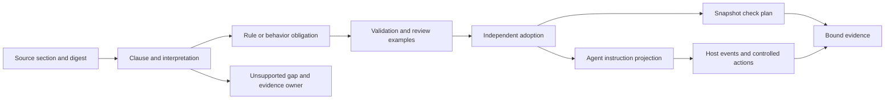
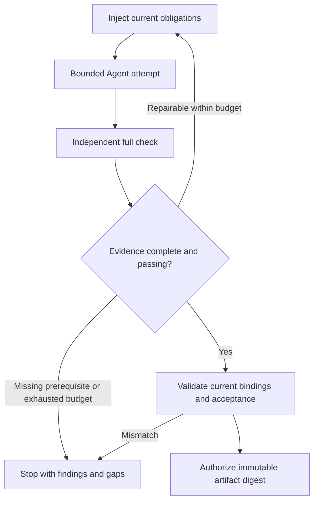

# Rule capabilities and Agent behavior contracts

[简体中文](../../zh/03-architecture/07-rule-capabilities-and-agent-contracts.md) · [Volume index](README.md)

This chapter explains how rule evaluation and Agent behavior contracts fit the
same evidence model. It describes implemented interfaces and their boundaries;
use `capabilities` to establish whether a particular binary supports them.
Protocol fields and budgets belong to the reference chapters, not a future roadmap.

## Five complementary mechanisms

| Mechanism | Evidence it consumes | Boundary |
| --- | --- | --- |
| Text patterns | Explicitly selected text or names | A match proves a text signal, not calls, types or data flow. |
| AST and project facts | Parsed entities and supported producer facts | Parsing proves structure; semantic claims require an appropriate producer. |
| Bounded operators | Typed predicates, collections and aggregates | Composition cannot supply missing facts or execute arbitrary code. |
| External checks | Project command results and normalized reports | Successful exit alone cannot prove report completeness. |
| Agent instructions | Adopted behavior obligations projected as a Prompt | Compliance needs evidence; enforcement requires a supported host entry point. |

These mechanisms compose rather than form independent engines. A test naming
rule can select AST entities and match names; an operator can require a nonempty
collection. A delivery obligation combines instructions, full-check evidence
and a host that controls the delivery transition.

Internally, keep three axes separate: fact source, rule expression and decision
owner. Text, AST, project and report adapters supply facts. Deterministic rules
and obligations express requirements. The gate, Agent, host and human reviewer
have distinct decision authority. Optional warning judgment remains advisory
and cannot change the deterministic gate.

## From source text to evidence

Authoring translates explicit source clauses into reviewable candidates before
execution. The deterministic check does not interpret prose at runtime.
Schema validity proves shape, source binding proves the selected bytes, and
adoption records policy acceptance; none alone proves the translation sufficient.

[Constraint coverage](../02-reference/07-constraint-coverage.md) links declared
clauses to configured checks and records unsupported or stale mappings.
[Operators](../02-reference/02-rules.md) combine complete facts under
shared budgets. Missing facts never become an empty collection, and negation or
boolean evaluation cannot convert incomplete evidence into pass.
[Agent contracts](../02-reference/09-agent-contracts.md) project adopted obligations
for the consuming Agent. Their readiness is separate from check completion.

## Instructions, checks and host control

| Layer | Responsibility | Evidence boundary |
| --- | --- | --- |
| Prompt / Skill | Explain applicable obligations and repair steps | Supplied bytes do not prove understanding or compliance. |
| Qualitygate | Run configured checks and verify input/report bindings | Results cover the selected facts and scope. |
| Rust Agent host | Inject instructions, recheck independently and guard delivery | Controls apply only at its supported entry points. |

The [Rust host](../02-reference/10-agent-host-and-delivery.md) pins evaluator,
base, policy and task inputs. It supplies current obligations before each process
attempt and reloads them on repair, explicit resume or handoff. It captures its
own full reports instead of trusting Agent-supplied report paths.

Supported controls cover Prompt injection, policy integrity, final full checking
and immutable delivery. Arbitrary tool authorization, final natural-language
responses and in-process context recovery remain unsupported. Required missing
controls block readiness to launch; optional gaps remain visible. The host is
not an OS sandbox, and repository instructions cannot expand its permissions.

## The delivery transition

Delivery uses the same in-memory snapshot as verification. Export produces a
content-addressed artifact; later worktree changes cannot enter it. The host
binds authorization to that artifact and current report, policy, task, scope,
contract and injection receipt. Recipients verify the artifact digest before use.
Read-only permissions do not authenticate storage.

A policy change requires its own review and revalidation. A source or task change
invalidates old evidence. Failure, timeout and budget exhaustion retain separate
reasons, and warnings remain visible even when the gate passes.

## Ownership and implementation evidence

The [development view](03-development-view.md) owns the executable module and
dependency contract. Domain types carry shared serializable contracts and pure
judgments; config validates them; adapters supply facts; application orchestrates
checks and projections. Snapshot, runner, env, paths and net retain their existing
I/O boundaries. No second gate lives in the CLI or external producer.

[Rule engine implementation](06-rule-engine-implementation.md) details dispatch,
entity matching and lint reuse. The [evidence index](../04-contributor-guide/03-requirements-to-test-evidence.md)
links constraint, operator, Agent contract, host and delivery requirements to
repeatable tests, including missing facts, stale bindings and delivery races.

---

[Previous: Rule engine implementation](06-rule-engine-implementation.md) · [Contents](../README.md) · [Next: Development and quality gates](../04-contributor-guide/01-development-and-quality-gates.md)
