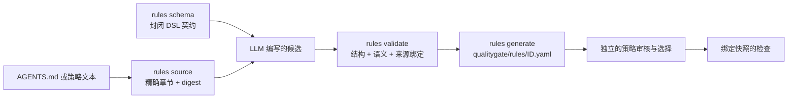

# Schema 驱动的仓库规则

[English](../../en/01-user-guide/06-schema-guided-repository-rules.md) · [本卷目录](README.md) · [规则参考](../02-reference/02-rules.md)

Qualitygate 的项目规则编写建立在两个核心观点上：

1. 可执行规则是受封闭 JSON Schema 管理、带版本的结构化数据，不是非正式 prompt，也不是任意插件代码。
2. `AGENTS.md` 等仓库说明是规范来源。LLM 可以把其中可执行的条款翻译为规则候选，但必须由匹配版本的
   CLI 绑定精确来源、校验 Schema 与语义、发布候选，并在之后针对快照执行。

这种分工让自然语言意图可审核，同时避免把模型解释本身变成门禁判定。



## 阅读规则契约

编写前先运行 `qualitygate capabilities --format json`，再导出目标规则格式的 Schema：
v1 使用 `rules schema`，v2 使用 `schema operator-rule`，1.0.0 的 V3 命名集合与词法 lambda
使用 `schema operator-rule-v3`。[统一规则参考](../02-reference/02-rules.md)说明字段、运行时要求和验证边界。
从一条明确、可测试的约束开始；无法表达的义务保留为缺口，不猜测或扩张规则含义。
以下文件行数示例使用 v1，1.0.0 继续支持这一格式。

## 在不编造策略的前提下转换 `AGENTS.md`

首先导出运行时契约，并绑定精确规范章节：

```bash
qualitygate --root . rules schema --format json
qualitygate --root . \
  rules source --document AGENTS.md --section "Quality contract" --format json
```

把返回的 `source` 对象原样复制到候选中。例如，文件行数限制可以采用以下结构；其中缩写 hash 必须
替换为 `rules source` 返回的精确值：

```yaml
schema_version: 1
id: authored-file-line-limit
version: 1
source:
  document: AGENTS.md
  section: Quality contract
  content_hash: "sha256:<rules source 返回的精确 digest>"
language: []
required: true
severity: error
applies_to:
  paths: ["src/**/*.rs", "tests/**/*.rs", "docs/**/*.md", "*.md", ".github/workflows/*"]
requires_capabilities: [files]
when:
  entity: file
  change: all
then:
  max_lines: 1000
fix: 拆分文件，同时保留其 ownership 与测试契约。
```

再根据其余每条约束真正需要的证据分类：

| 仓库约束示例 | 正确表示方式 |
| --- | --- |
| “源码、测试、文档和 workflow 文件不超过 1,000 行。” | project rule：`file`、`change: all`、限定路径、`max_lines: 1000`。 |
| “这些 owner 或测试文件必须存在。” | 完整文件清单 project rule 加 `required_paths`。 |
| “禁止从 A 层 import B 层。” | 源码 import 足以证明时使用解析后的 `import` 规则；否则使用带项目事实的 `module-boundary`。 |
| “依赖必须无环。” | 复用架构 lint 或有界 command check；文本正则无法证明图属性。 |
| “必须运行 fmt、clippy 和全部测试。” | policy command check，不是 project-rule assertion。 |
| “必须由 reviewer 判断设计质量。” | 人工/manual acceptance；不能把判断编造成正则。 |

只有有限 DSL 能表达的条款才成为 project-rule 候选。不支持的条款应保留为 capability gap，或路由到
既有 lint、AST/project adapter、command check 或人工决策。

在获准的临时路径写好候选后，通过匹配版本的 CLI 校验和发布：

```bash
qualitygate --root . rules validate candidate.yaml --format json
qualitygate --root . rules generate --input candidate.yaml --format json
qualitygate --root . rules validate --format json
```

`generate` 原子写入 `qualitygate/rules/<id>.yaml`，但不会启用规则。采用规则是独立策略变更：选择
project-rule 目录、在目标 profile 启用 ID、保留 source review，并重新执行快照检查。新 digest、生成
成功或 LLM 建议都不构成批准。

## Skill over CLI

对于 Agent，Qualitygate Skill 是 CLI 之上的决策与安全层：它指导 LLM 选择正确工作流和证据强度，
判断何时需要变更授权，以及何时约束无法表达。CLI 才是 Schema 导出、精确来源绑定、校验、生成、
策略规划和检查的可执行权威。LLM 不得模拟这些操作、手写未经验证的“等价格式”，也不能把 prose
解释当作门禁通过。

完整 Agent 流程见 Skill 随包的[规则编写指南](../../../skills/qualitygate-cli/references/rule-authoring.md)，
运行时边界见[规则引擎架构](../03-architecture/06-rule-engine-implementation.md)。

## 公共审查知识包

[审查卡](../../../skills/qualitygate-cli/references/review-pack.md)覆盖并发、生命周期、边界安全、
跨路径一致性和测试质量，另有流程义务卡。每张卡定义适用条件、问题、必要证据、反例和证据不足出口。
这些内容指导审查，不证明代码语义正确。
[义务示例](../../../skills/qualitygate-cli/references/examples/review-obligations.yaml)复用现有
`agent-obligation` v1 协议，提供六条面向 implementer/reviewer 的可选、未采用指令义务，
不引入新的 CLI 或 Prompt 规则协议。

在其他仓库使用时：

1. 仅将选中卡片的标题与完整章节复制到版本控制内的仓库相对路径。安装指南保留在 Skill 中，
   避免复制后相对链接失效。仓库外的已安装 Skill 路径不能作为快照规范来源。
2. 导出 `qualitygate schema agent-obligation --format json`。对每张选中的卡运行
   `qualitygate rules source --document <仓库路径> --section <精确标题> --format json`，
   原样使用返回的来源对象。示例摘要绑定原路径中的随包文档；复制、修改或翻译后需重新绑定。
3. 仅将选中的义务合并到现有策略的 `agent_obligations`，不覆盖其他配置，不复制采用记录。
   `must` 需保留核心审查步骤：投影不会自动把来源正文展开到 Prompt。
4. 运行 `qualitygate config --show --format json` 获取 `agent_bindings`，由获准审核者根据实际审核
   记录采用，具体见 [Agent 契约流程](../02-reference/09-agent-contracts.md)。
5. 运行 `qualitygate agent-contract --worktree --role reviewer --format json`，保持与验证相同的
   base、task 和 policy 输入。读取 Prompt 与缺口列表；未采用的可选卡不会进入 Prompt，
   即使 `ready` 为 true 也不表示已经遵守义务。

当前仅按角色/任务选择，不会根据 diff/AST 自动路由。来源或义务变化后需重新绑定与审核。
审查结果保留具体文件、符号或调用链证据、反证与明确的证据不足状态，不能将其转换成通过。
`judgment run` 可对已完成检查产生的单个 warning 做可选分诊，不是通用 diff 审查入口，
也不改变确定性门禁。


---

[上一章：规则配置](03-rule-configuration.md) · [全书目录](../README.md) · [下一章：Agent 修复与验收](04-agent-repair-and-acceptance.md)
