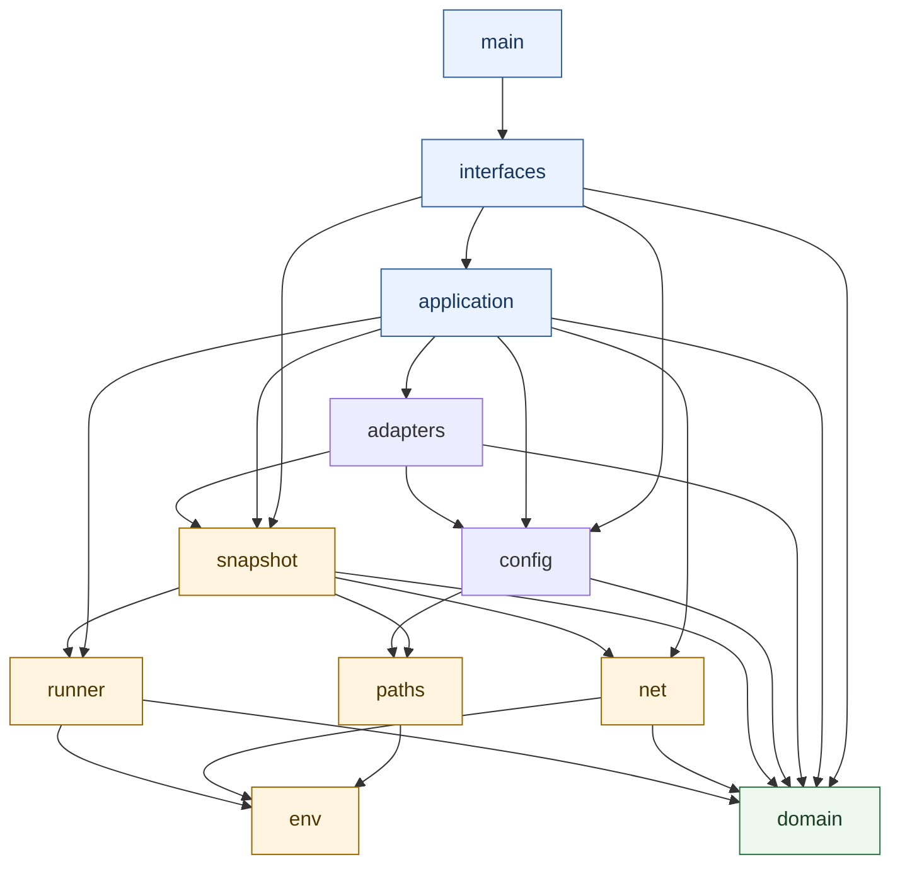

# 开发视图

[English](../../en/03-architecture/03-development-view.md) · [本卷目录](README.md)

开发视图把逻辑职责映射到 Rust 源码 owner、允许 import、测试面和构建期约束。它回答“修改应放在哪里、
允许依赖什么”。

Rust crate 使用显式顶层 owner 和无环依赖图。crate root 只声明 owner；可执行入口仅委托给接口层。

业务领域模块直接位于 `src/qualitygate` 第一层。内聚的多模块实现直接放在对应领域目录内，
单模块领域如 `content_digest` 使用 `content_digest.rs`，
不再嵌套 `application`、`config`、`domain`、`interfaces`、`adapters` 包装目录。
原有 API 通过同层的 `application.rs`、`config.rs`、`domain.rs`、`interfaces.rs`、
`adapters.rs` 文件保持兼容。每个具体实现模块都有明确的能力归属：契约保持纯计算，
配置负责加载与规划，应用负责编排，接口负责解析与呈现。兼容导出不改变能力权限。

| 业务模块 | 负责的关注点 |
| --- | --- |
| `agent_runtime` | 投影 Agent 义务并运行有界 Agent 宿主。 |
| `policy_lifecycle` | 认证、激活、提升、验证和回滚策略版本。 |
| `rule_catalog` | 发现、编写、参数化和查询规则定义及算子。 |
| `constraint_coverage` | 将约束条款绑定到执行证据并计算覆盖情况。 |
| `gate_execution` | 调度已规划的检查并生成最终门禁报告。 |
| `compatibility_verification` | 准备兼容性输入并验证生产者与消费者的兼容性。 |
| `test_effectiveness` | 针对当前和先前代码执行测试，验证反例证据。 |
| `snapshot_preflight` | 诊断快照获取、工具前提与执行准备情况。 |
| `selfcheck` | 运行内置评估器语料并报告已验证形态与缺口。 |
| `pilot_acceptance` | 验证试点清单、调度、预算和验收记录。 |
| `judgment_review` | 请求并验证外部咨询判断，不授予验收权限。 |
| `report_evidence` | 解析已捕获的报告来源、整理门禁证据并渲染报告。 |
| `external_acceptance` | 认证外部证明、人工验收和来源证据。 |
| `check_planning` | 有界加载配置并构建经过验证、按依赖排序的检查计划。 |
| `resource_selection` | 选择变更资源并执行排除规则与快照获取预算。 |
| `repair_feedback` | 构建可操作的修复反馈并验证重放交付的身份。 |
| `content_digest` | 提供纯字节摘要计算和摘要格式校验。 |
| `xml_parsing` | 进行有界 XML 文档解析及命名空间工作量核算。 |
| `cli_dispatch` | 解析 CLI 根命令并分派到各领域接口。 |
| `rule_evaluation` | 基于捕获的事实执行内置规则及版本化自定义算子。 |
| `source_analysis` | 使用有界工作线程提取语法、语言绑定和变更实体。 |
| `maven_analysis` | 解析 Maven 项目模型、依赖声明和使用证据。 |
| `python_analysis` | 解析 Python 项目、依赖条件和安装包元数据。 |

下图描述能力归属的依赖关系，不依赖物理目录层次。架构门禁把每个 `feature::module`
映射到已审查的能力归属，并把旧兼容路径解析为相同归属，拒绝未登记模块。
领域根模块只能声明 `tests/quality/architecture_owners.rs` 中登记的具体模块，不能隐藏
实现或宽泛重导出。例如 `agent_runtime::host_decisions` 保持纯计算，
`agent_runtime::host_controller` 负责编排。Bazel 通过 `bazel/owners/*.rs` 与
`//src/qualitygate:<owner>` 目标按能力分别编译，防止纯契约引入编排依赖。
Cargo 和 Bazel 同时提供新领域路径与原有公开 API。架构报告继续保留源文件摘要及文件、行号证据。

箭头表示“允许依赖”。所有 owner 都可使用纯 domain 契约，但只有命名的边界 owner 才能访问相应外部
能力。依赖图有意保持非对称：adapter 可消费 snapshot 事实，snapshot 不能反向导入 adapter；
interfaces 调用 application 用例，application 不解析 CLI 参数。

| Owner | 职责 |
| --- | --- |
| `domain` | 可序列化契约与纯 gate 决策；禁止进程、文件系统、网络和环境 I/O。 |
| `env` | 环境变量读取及其派生值。 |
| `paths` | 受限路径验证与安全解析。 |
| `net` | 有界网络访问和远端获取契约。 |
| `runner` | 有界异步进程执行与证据捕获。 |
| `snapshot` | Git 选择器、不可变文件获取、变更映射与物化。 |
| `config` | 严格的策略/任务加载、验证与计划。 |
| `adapters` | 语言/项目事实与外部报告归一化。 |
| `application` | 检查编排、反馈、复验和用例协调。 |
| `interfaces` | CLI 参数解析与输出渲染。 |
| `main` | 只委托给 `interfaces` 的进程入口。 |

共享契约放在对应业务领域的纯模块中，架构归属表将这些模块标记为 `domain` 能力。
接口层不直接执行外部 I/O。阻塞的文件系统与
解析工作和异步编排隔离；网络、环境和路径访问各有专门 owner，便于能力审核。

`check_planning::dependencies` 为每次图操作建立标识和邻接索引，验证、profile 前置依赖闭包及命令
适用性均使用迭代遍历。拓扑顺序始终选取策略声明中最早且已就绪的节点；未知、重复、禁用或有环的
依赖仍然报错。深反向链不消耗递归栈，也不需要反复扫描整张图。

`snapshot::ScopeIndex` 在单次操作中借用快照，只索引一次旧路径。清单、诊断、覆盖率及保留标记
循环复用索引，无需为每个路径扫描全部变更。当前键优先，重复旧路径保持快照顺序首个匹配项，
仓库/交付与反馈范围语义不变。公开可变的快照不缓存索引；后续操作根据当前变更重新构建。

`xml_parsing::xml_budget` 负责配置发现与适配器共享的纯命名空间工作量计数，只接收计数、限制作用域
栈并检查算术。XML token 化、树解析和各 profile 的错误语义仍归各自的消费层负责。

`report_evidence::tool_reports::sarif_locations` 负责引用步骤、文本工作量和保留位置预算，解析表引用时借用
逻辑名称，位置保留前先计量。`report_evidence::tool_reports::json_budget` 用无文件系统访问的计数器测量
紧凑 JSON；归一化结果在追加前复用该计数器，避免仅为测量序列化大小而分配 JSON 副本。
普通静态检查和测试诊断复用其有界追加操作，同一报告内的所有文件共享预算；计数器不改变
生产者校验、源路径映射和执行的职责归属。

`report_evidence::report_sources` 负责诊断、受影响范围和覆盖率路径对捕获输入的解析。完整路径直接查询
快照映射；简写路径为当前版本和基线版本分别按需建立索引，借用原有字符串并按反向字节顺序排序。
二分查找定位首个目录边界匹配项，存在第二项即拒绝歧义。覆盖率和诊断门禁均依赖这一独立模块，
不再相互调用路径辅助函数；路径限制、大小写敏感性及基线重命名处理保持不变。
同一解析器在原始源文件行号验证后，按需索引基线重命名。索引借用旧路径和当前路径，忽略其他
变更类型，并复用空结果。重复旧路径保持快照顺序中的首个目标，不递归追踪重命名链。

`check_planning::yaml_budget` 统一负责 YAML 展开预检，在既有重复键和类型化解码前访问值，
不物化集合，也不复制别名字符串。配置、任务、规则和验证套件共享该边界；application
的策略信任加载在既有阻塞工作中调用公开、类型化的 `policy_lifecycle::policy_acceptance::parse_trust`。
Bazel 将 owner 编译为独立 crate 时也使用该边界，通用 YAML 解码器保持在配置层内部。

`check_planning::yaml_scalar_work` 先通过 Saphyr 解析器事件累计标量文本，再进入数值解析。它缓存
已完成锚点的成本并跟踪尚未关闭的集合，拒绝递归别名，保留源码位置，不构建 YAML Value 树。
既有 Serde 解码器继续负责值和类型化语义（包括重复键拒绝）；解析错误和事件预算错误统一进入
配置诊断边界。

`xml_parsing::document` 统一负责报告、Maven 模型和兼容性证据的有界 XML 树解析。
调用方执行各自的字节预算，报告特有的 DOCTYPE 归一化留在 `reports`。迭代预检在树解析器比较
重复名称之前，限制每个元素 1,024 个属性、整个文档 100,000 个属性，命名空间声明计入。
项目和兼容性适配器
依赖这个共享叶模块，无需导入报告格式处理代码。

配置发现的建议性 Maven 清单校验由 `check_planning::discovery::maven_manifest` 负责，在生成命令
候选前限制 XML 深度、节点和属性数量，并把不支持的清单记录为发现缺口。该 profile 位于 `config` 内，
不导入适配器，也不产生已解析的项目事实；适配器报告失败继续使用独立的执行状态语义。

CLI 根路径解析委托给 `snapshot_preflight::repository_root`，通过 `spawn_blocking` 调用 `paths`，
保留原生 canonicalize 结果和错误上下文。Clap 类型化参数转换仅归 `interfaces` 所有；domain
保留序列化契约。`content_digest` 统一字节摘要和格式校验，调用方仍负责序列化及流式哈希分帧。
`rule_catalog::rule_parameters` 为配置发现、校验和适配器模式编译提供共享纯契约；规则诊断文案由
builtin 定义提供，执行器无需按规则 ID 分支。依据与边界见
[Clean contract 评审](../../../knowledge/best-practices/engineering-standards/guides/clean-contracts.md)。

架构门禁禁止 domain 依赖 Clap，并在 domain/interfaces 保留路径 I/O 方法名：`canonicalize`、
`try_exists`、`exists`、`metadata`、`symlink_metadata`、`read_dir`、`read_link`、`is_file`、`is_dir`。
普通方法调用、宏 token 和显式 `std::path::Path`/`PathBuf` 调用均在检查范围内。这是保守的语法约束，
不进行接收者类型推断，也不证明检测了所有可能的 I/O。

架构测试解析全部生产 Rust 源码，解析模块与 import 路径（含分组、别名、宏和条件引用），检查 owner
边、禁止能力和环，并输出可审核的源码摘要/行号报告及 DOT 图。隐藏根导出、歧义模块文件、未知 owner、
宽泛外部 glob 和纯 domain 中的 I/O 都会被拒绝。

文档、示例、测试与构建元数据可调用公共接口，但不会形成新的生产 owner。修改模块所有权或 import 后，
除编译外还必须运行架构门禁并审核其边证据。

这种划分让审核者分别回答三个问题：决策是否纯且可序列化，外部动作是否受限有界，以及编排是否在不
产生依赖环的前提下组合能力；同时也让可复用 library 不依赖可执行接口。

源码目录与命名属于架构契约。领域、子模块和文件统一采用描述明确的
`snake_case`，不新增 `common`、`utils` 等含糊归属。叶模块使用 `name.rs`，
有子模块的模块使用 `name/mod.rs`；单元测试使用 `name_tests.rs` 或模块目录内
的 `tests.rs`，拆分场景测试时按具体场景命名。协议适配器以真实格式命名，
例如 `sarif.rs`、`cobertura.rs`；`xml_reports.rs` 明确承担多种 XML 报告分派。
旧适配器 API 保留为同层文件兼容出口，实现和测试直接放在业务领域目录中。
原同名职责使用具体名称区分，例如 `rollback_contracts`、`rollback_store`、
`rollback_workflow`。删除空目录和只包装角色的目录，不为转接用的 `mod.rs` 保留一层目录；
`tool_reports`、`syntax` 等包含内聚子模块的实现仍使用子目录。兼容出口的共享测试放入
`contract_tests`，迁移后的 Bazel 入口统一放入 `bazel/owners`。`env`、`paths` 等单文件
基础能力也使用同层 `.rs` 文件。架构门禁验证命名，
禁止角色包装目录和空目录，并拒绝适配器依赖 CLI 或应用编排。

Miri 使用工作流中已审查的纯模块清单，架构门禁要求该清单与所有纯模块的能力归属表
完全一致。四个分片均先列出所选测试并拒绝空选择，再执行同一选择；上传的测试清单
保留可审查的执行范围。Miri、ASan 继续与稳定工具链检查分开运行。

---

[上一章：进程视图](02-process-view.md) · [全书目录](../README.md) · [下一章：物理视图](04-physical-view.md)
