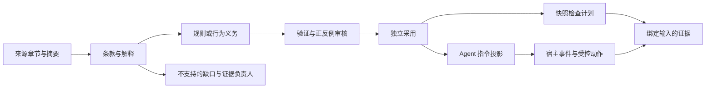
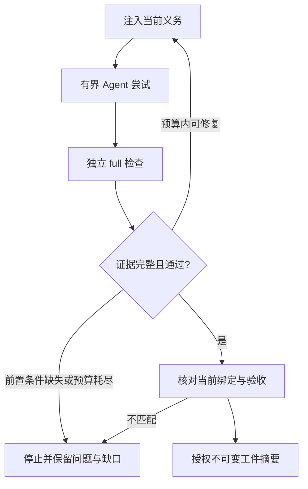

# 规则能力与 Agent 行为契约

[English](../../en/03-architecture/07-rule-capabilities-and-agent-contracts.md) · [本卷目录](README.md)

本章说明规则求值与 Agent 行为契约如何共享证据模型，描述已实现接口及其边界。
具体二进制是否支持，应通过 `capabilities` 确认。协议字段和预算统一见参考手册，不再混入未来路线图。

## 五类可组合机制

| 机制 | 消费的证据 | 边界 |
| --- | --- | --- |
| 文本模式 | 明确选中的文本或名称 | 命中只证明文本信号，不证明调用、类型或数据流。 |
| AST 与项目事实 | 解析实体及受支持 producer 提供的事实 | 解析证明结构；语义结论需要对应事实生产者。 |
| 有界算子 | 类型化谓词、集合和聚合 | 组合不能补出缺失事实，也不执行任意代码。 |
| 外部检查 | 项目命令结果与归一化报告 | 退出成功本身不能证明报告完整。 |
| Agent 指令 | 已采用行为义务的 Prompt 投影 | 遵守情况需要证据；强制执行需要受支持的宿主入口。 |

这些机制可以组合。例如测试命名规则先选 AST 实体，再匹配名称，并由算子要求集合非空。
交付义务则组合指令、full 检查证据和控制交付状态转换的宿主。

内部设计分别表达事实来源、规则表达和判定主体：文本、AST、项目与报告适配器提供事实；确定性规则
和义务表达要求；gate、Agent、宿主和人工审核者各有判定权限。可选的 warning judgment 保持建议性，
不能改变确定性 gate。

## 从规范文本到证据

编写阶段把明确条款转为可审核候选；确定性检查不会在运行时解释自然语言。Schema 校验证明形状，
来源绑定确认选中的字节，采用记录表达策略接受；任何一项都不能单独证明翻译充分。

[条款覆盖](../02-reference/07-constraint-coverage.md)将声明条款关联到配置检查，记录不支持或失效的映射。
[有界算子](../02-reference/08-bounded-operators.md)在共享预算内组合完整事实：缺失事实不能变为空集合，
否定和布尔求值不能把未完成证据变成通过。
[Agent 契约](../02-reference/09-agent-contracts.md)向实际执行任务的 Agent 投影已采用义务，投影就绪与
检查完成分别判定。

## 指令、检查与宿主控制

| 层次 | 职责 | 证据边界 |
| --- | --- | --- |
| Prompt / Skill | 说明适用义务和修复步骤 | 提供字节不证明理解或遵守。 |
| Qualitygate | 运行配置检查，验证输入与报告绑定 | 结果只覆盖选定事实和范围。 |
| Rust Agent 宿主 | 注入指令、独立复验并控制交付 | 控制仅适用于受支持的入口。 |

[Rust 宿主](../02-reference/10-agent-host-and-delivery.md)固定执行器、base、策略和任务输入，每次启动进程
前提供当前义务，修复、显式恢复或切换时重新加载。它直接采集自己的 full 报告，不信任 Agent 提供的
报告路径。

支持的控制包括 Prompt 注入、策略完整性、最终 full 检查和不可变交付。任意工具授权、自然语言最终
答复及进程内部上下文恢复仍不支持。缺少必需控制会阻止启动，可选缺口继续可见。宿主不是操作系统
沙箱，仓库指令不能扩张其权限。

## 交付状态转换

交付使用与验证相同的内存快照，导出按内容寻址的工件；之后的工作区修改不会进入其中。
宿主把授权绑定到该工件及当前报告、策略、任务、范围、契约和注入回执。接收者使用前核对摘要，
文件只读权限不能认证存储。

策略变化需独立审核并复验；来源或任务变化后旧证据失效。失败、超时与预算耗尽保留不同原因，
门禁通过时也继续展示警告。

## 所有权与实现证据

[开发视图](03-development-view.md)维护可执行的模块及依赖契约。domain 承载共享序列化契约和纯判定，
config 负责验证，adapters 提供事实，application 编排检查和投影。snapshot、runner、env、paths、net
保留既有 I/O 边界，CLI 与外部 producer 不建立第二套 gate。

[规则引擎实现](06-rule-engine-implementation.md)解释分派、实体匹配和 lint 复用。
[证据索引](../04-contributor-guide/03-requirements-to-test-evidence.md)将条款、算子、Agent 契约、宿主和交付
需求关联到可重复测试，包括事实缺失、绑定失效和交付竞态。

---

[上一章：规则引擎实现](06-rule-engine-implementation.md) · [全书目录](../README.md) · [下一章：开发与质量门禁](../04-contributor-guide/01-development-and-quality-gates.md)
