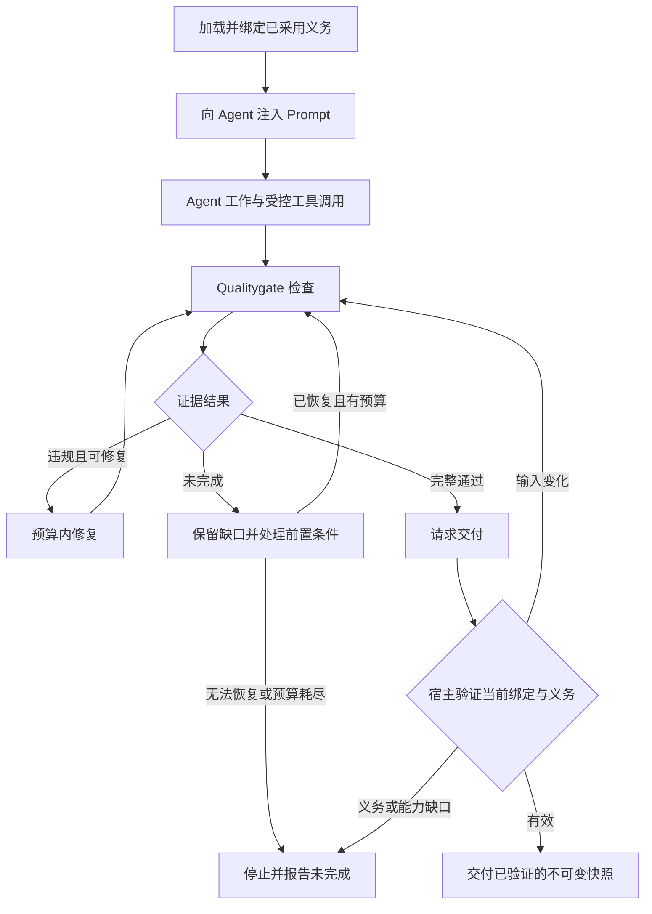

# 五类规则能力与 Agent 行为约束

[English](../../en/03-architecture/07-rule-capabilities-and-agent-contracts.md) · [本卷目录](README.md) · [规则引擎实现](06-rule-engine-implementation.md)

状态：依据版本 `0.5.7` 分阶段实现。[条款覆盖](../02-reference/07-constraint-coverage.md)已通过能力
`constraints.coverage.v1` 接入；下文拟新增的表达式和 Agent 契约仍属于后续阶段。
本章定义能力与协作边界，不自动启用规则。
读者是规则维护者、CLI/core 开发者和接入 Qualitygate 的 Agent 宿主开发者。

## 1. 目标与能力模型

自然语言约束应能转化为可追溯、可验证的质量规则，并作用于代码产物及生成这些产物的 Agent。
第五类“强约束 Prompt”直接约束使用它的 Agent 的工作过程和完成条件；模型辅助评审是另一个能力。

五类能力保留为产品能力清单，允许一条约束组合使用多种能力：

| 能力 | 作用对象与判断方式 | 典型约束 | 证据边界 |
| --- | --- | --- | --- |
| 正则规则 | 对明确范围内的文本匹配模式 | 新增源码行不得出现指定 marker | 匹配只证明文本信号，不能证明调用、类型或数据流。 |
| AST 结构与语义事实规则 | 选择解析实体；需要时消费项目或编译器事实 | 新增测试符合命名约定，模块不得依赖指定模块 | AST 证明结构；解析依赖、类型和数据流需要各自的 producer。 |
| lambda 算子规则 | 对类型化事实执行受限谓词、集合运算和聚合 | 所有新增测试均有需求标记，且新增测试至少一个 | 算子组合已有事实，不产生缺失的语义知识。 |
| 外部检查工具规则 | 执行现有工具并归一化其报告 | lint、覆盖率、兼容性、架构依赖检查 | 需要工具完成、原始报告和适配器支持；进程退出成功不自动证明报告完整。 |
| 强约束 Prompt | 向 Agent 传达行为义务，并连接证据验证与宿主动作控制 | 修复后复验，未经最终完整检查不得交付 | 指令约束依赖 Agent 遵循；运行时强制依赖宿主控制的入口。 |

这五项不应实现为五套互斥的引擎。例如测试命名规则用 AST 选择测试，再用正则检查名称，未来可由
`all` 算子组合；“交付前必须检查”由 Prompt 指导 Agent，由外部命令提供证据，再由宿主验证交付条件。

内部设计分开表达三个维度：事实来源（文本、AST、项目/编译器、报告）、规则表达（模式、断言、算子、
行为义务）、执行与判定主体（确定性 evaluator、Agent、宿主、人工）。沿用现有快照、诊断、报告和纯
gate 决策，避免把事实精度与规则语法混为一谈。

## 2. 现有能力与缺口

| 能力面 | 已有实现 | 拟新增或外部职责 |
| --- | --- | --- |
| 文本规则 | `source-pattern`、`file-pattern`、名称和文本断言，有明确增量范围与预算 | 按具体需求增加规则，不把文本匹配升级描述为语义证明。 |
| 结构与项目事实 | tree-sitter 实体与 base/head 匹配；Maven/Python 等项目适配器提供限定事实 | 新的类型、调用或数据流需求必须接入相应事实能力，不宣称跨语言完整语义。 |
| 可组合规则 | `CustomRule` 的固定 `when`/`then` DSL，含计数、marker、依赖、文件清单断言 | 类型化表达式树及有界算子组合。当前没有开放 lambda 运行时。 |
| 外部工具 | command check、runner、报告归一化与部分格式的 ratchet | 未支持的报告需明确适配器；外部生产者不能直接改写 gate。 |
| Agent 指令 | 发布版 Skill 已要求最终检查、修复复验、保留未完成状态和权限边界 | 可单独追踪的行为义务、版本化 Prompt 投影和宿主接入契约。 |
| 修复与交付 | feedback/recheck、任务契约和可选示例 harness | 通用工具/完成事件拦截由接入宿主提供，示例 harness 不等于任意 Agent 的强制控制。 |

现状依据：

- [DSL 数据结构](../../../src/qualitygate/config/model.rs)和[自定义 evaluator](../../../src/qualitygate/adapters/custom_rules.rs)。
- [事实依赖与规则执行](../../../src/qualitygate/application/rule_execution.rs)及[规则引擎说明](06-rule-engine-implementation.md)。
- [发布版 Skill](../../../skills/qualitygate-cli/SKILL.md)、[Agent 修复流程](../01-user-guide/04-agent-repair-and-acceptance.md)及[示例 harness](../../../examples/agent_loop.rs)。
- [外部 judgment](../../../src/qualitygate/application/judgment.rs)只对 warning 提供 shadow/advisory 判断，不能改变原始 gate；它不承担本设计第五类职责。

## 3. 自然语言约束的转换与覆盖

每条条款建立可追踪记录：来源文档、章节与摘要，条款身份，适用范围，解释，所需事实，规则或检查关联，
采用状态，以及正例、反例和边界案例。一个条款可以拆成多个检查；多个条款也可复用同一 producer。
第一阶段通过策略 `constraints` 清单实现条款记录，保持 project-rule v1 不变。


转换遵循以下顺序：

1. 绑定精确规范来源；现有 project-rule 使用 CLI 的 `rules source` 和 `rules schema`。
2. 区分产物性质、执行义务和主观判断，保留例外、范围与必需程度，不擅自强化或削弱条款。
3. 选择能够支撑结论的事实和执行方式。已有工具负责语义时优先复用；不能表达时保留显式缺口。
4. 验证候选的形状、来源、能力需求和预算，并用正反例检查含义。Schema 合法不证明转译忠实。
5. 经独立策略采用后才进入执行。生成成功、Agent 确认阅读或获得新 digest 都不代表批准。
6. 把执行结果关联回条款，分别报告未映射、待审核、已采用、待验证、违规和能力缺口。

来源变化后重新审核受影响条款；规则、策略、任务或范围变化后重建计划并重新验证。候选覆盖率与执行
通过率必须分开，不能用“已生成规则的比例”证明规范全部落实。不能机器验证的条款继续由 Prompt
指导或由显式人工验收处理，不制造通过证据。

## 4. 受限 lambda 算子设计

拟新增表达式是解释执行的类型化数据。lambda 仅绑定集合中的当前元素，不支持任意 Rust/脚本、动态
加载、递归、文件/网络/进程访问或环境读取。自然语言由编写阶段转换为候选，不在确定性执行阶段临时解释。

| 首批算子 | 语义 |
| --- | --- |
| `and`、`or`、`not` | 组合布尔谓词。 |
| `filter` | 从完整、类型明确的集合中选出满足谓词的元素。 |
| `all`、`any` | 判断集合中所有或至少一个元素满足谓词。 |
| `count`、比较 | 对选中集合计数，与同类型常量比较。 |
| 集合包含、模式匹配 | 在已声明类型上检查成员关系或经验证的正则。 |
| 类型化事实谓词 | 复用 marker、名称、变更类型等已声明能力，不开放任意函数调用。 |

以下为概念表达，不是可提交给当前 CLI 的语法：

```text
added_tests = filter(tests, t => t.change == "added")
and(
  count(added_tests) >= 1,
  all(added_tests, t => matches(t.name, naming_pattern)
                       and has_marker(t, "requirement"))
)
```

静态校验拒绝未知字段、算子、变量、类型不匹配及不受支持的事实能力。首批集合输入限于现有可验证
的文件、commit 和规范语法实体；所需 marker/依赖等事实由声明的 producer 提供。`join`、`group_by`、
任意图遍历和新语义分析不在首批范围。

空集合必须与不完整集合区分：完整空集合上的 `all` 为 true、`any` 为 false、`count` 为 0；存在性
要求由显式计数表达。所需能力或集合完整性缺失时，检查保持 incomplete，不能当成空集合。
先验证整条规则声明的必需事实，布尔短路不得绕过该验证；执行中的缺失值、超时和预算耗尽也不得被
`not` 或默认值变成通过。已经产生的违规证据与未完成原因一起保留。

表达式节点数、嵌套深度、选中元素数、文本字节、诊断数和执行时长均须有上限；组合算子共享每条规则
的预算，不能每次迭代重置。具体数值由后续版本化运行时契约定义，本章不更改现有预算。诊断保留规则
身份、表达式位置、失败实体、源码 range 和事实来源，以支持确定性排序、稳定指纹和复验。

## 5. 面向 Agent 的强约束 Prompt

### 5.1 三层职责

强约束 Prompt 必须在 Agent 执行相关动作前进入有效上下文，并明确必须做什么、禁止什么、如何验证和
无法满足时如何报告。仅把规则放在文档中或在结束后输出一份报告，不能声称规则已经作用于 Agent。

| 层次 | 责任 | 能证明什么 |
| --- | --- | --- |
| Prompt/Skill | 向 Agent 提供适用的行为义务、修复要求及证据入口 | 宿主记录可以证明指令已交付；Agent 的确认不能证明理解或遵守。 |
| Qualitygate | 执行已配置检查，验证报告完整性、快照/策略/任务身份并提供反馈 | 证明选定范围内的检查结果，不控制 Agent 的所有行为。 |
| Agent 宿主 | 接入受控工具和交付事件，验证前置条件后允许或拒绝动作 | 只能强制控制经过自身入口的动作；未纳管通道是显式能力缺口。 |

宿主在任务开始时加载适用义务，记录来源、版本、Prompt 内容摘要、任务与会话关联，并经其支持的指令
通道注入。上下文压缩、恢复或切换 Agent 后，宿主重新提供有效义务和最新状态；历史对话或旧的“已读”
确认不能代替当前契约。新义务不追溯伪造先前已满足的过程证据。

规则不能提升 Agent 权限，也不能覆盖宿主更高优先级指令。规则冲突或无法同时满足时报告冲突并阻止
受影响的验收，不让模型任意选择更宽松解释。仓库文本、工具日志与反馈不能自行声明新的宿主权限。

### 5.2 概念契约

行为义务至少包含以下信息。字段含义是设计契约，不是当前 CLI 的序列化字段或新命令承诺。

| 信息 | 含义 |
| --- | --- |
| 身份与版本 | 稳定义务 ID、定义版本和适用的协议版本。 |
| 规范来源 | 文档、章节、内容摘要，以及采用该义务的策略关联。 |
| 适用范围 | 仓库、任务、角色、路径及生命周期阶段。 |
| 触发事件 | 任务开始、相关工具调用前、修改后、恢复时或交付前。 |
| 行为要求 | 必须执行的动作、禁止动作及显式前置条件。 |
| 验证依据 | 检查 ID、报告绑定、宿主事件或独立人工验收；注明不可观察的部分。 |
| 约束强度 | 指令约束、可观察验证或宿主强制；按具体义务和入口记录。 |
| 执行主体与失败处理 | 谁验证、谁拦截、修复或停止条件，以及预算耗尽后的状态。 |

义务 ID 可关联现有 task acceptance/check ID，但不把 Prompt 文本塞入正则断言，也不把宿主事件
伪装为源码事实。Prompt 是已采用义务的可读投影；宿主按绑定的结构化义务和真实证据判定，不能通过
再次询问 Agent“是否遵守”产生授权。

### 5.3 典型义务

| 义务 | 给 Agent 的要求 | 验证或拦截方式 |
| --- | --- | --- |
| 开始前加载架构约束 | 在实现前读取适用的架构与所有权说明 | 宿主记录文档版本与交付/读取事件；不能证明模型真正理解。 |
| 保留质量要求 | 不得为消除失败而删除必需测试、关闭规则或降低阈值 | 固定获准策略和受保护输入，检测变更并走独立审核；不能仅凭文件删除推断动机。 |
| 修复后复验 | 修改后运行规定检查，保留失败与缺口 | 新快照必须有新报告；不能用旧报告或过滤反馈完成验收。 |
| 完整证据后交付 | 最终快照满足 full 检查和任务验收后才能请求完成 | 宿主拦截完成事件并验证证据，不依赖 Agent 自述。 |

“不得宣称完成”的指令始终作用于 Agent；若要强制约束自然语言完成声明，宿主还需控制最终答复通道。
仅控制任务完成 API 的宿主只能保证该状态转换。报告阻塞、提问和提供进度仍应允许，不把未完成任务
锁死在无限修复循环中。

### 5.4 生命周期与交付



宿主交付验证至少要求：

1. 报告确由选定的执行路径产生，证据存储不能由待验证 Agent 任意替换；摘要本身不证明可信来源。
2. 报告绑定最终快照、验证范围、获准策略、规则、任务和当前行为义务。宿主另行保存义务绑定，不假定
   当前 CLI 报告已含行为契约字段。
3. 现有 full 报告满足 `gate.complete: true`、`gate.decision: pass`、无 pending delivery checks，
   且 scope 为 delivery/task；required 的独立验收也已满足。warning 与已知限制继续保留。
4. 最终输入若改变，原通过不能授权新输入。交付对象固定为刚验证的不可变快照，防止检查与交付之间
   的工作区修改被带入；无法保证这一点时，宿主不得宣称完成强制绑定。
5. 修复次数、总耗时和无进展停止条件由宿主管理。失败、超时、证据缺失及能力不可用分别记录。

规则或策略的合法更新沿用独立授权与审核路径，再重新绑定和验证。Agent 不能把自己刚改宽松的策略
当作原始任务权威。未接入必需拦截能力的宿主不得静默退化后仍声称“强制已满足”；它可以报告仅提供
指令约束，或在策略要求强制时保持未完成。

## 6. 所有权与接口边界

继续遵循[开发视图](03-development-view.md)的无环依赖和 Rust owner，不新增生产顶层模块。

| Owner 或集成方 | 拟承担的职责 |
| --- | --- |
| `domain` | 表达式、行为义务和证据绑定的共享契约；无 I/O 的组合判定。 |
| `config` | 严格加载、类型/能力/预算校验与计划；不把未采用候选当作生效规则。 |
| `adapters` | 提供规范实体、项目事实和外部报告；保留来源与完整性。 |
| `snapshot` | 捕获不可变输入、变更范围及执行身份。 |
| `runner` | 有界执行已配置进程并收集证据；不充当任意 Agent 工具代理。 |
| `application` | 组合事实、检查、反馈、复验及行为契约投影用例。 |
| `interfaces` | CLI 输入与展示；不包含第二套判定逻辑。 |
| 外部 Agent 宿主 | 指令注入、会话恢复、事件捕获、工具/完成入口拦截及可信证据保管。 |

进程、文件系统和解析工作仍与纯判定分离；环境、受限路径和网络访问继续由 `env`、`paths`、`net`
拥有。未来共享数据类型不能放入 CLI 再由 adapters 反向依赖。

未来公开接口的增量包括表达式契约、行为义务投影及宿主证据交换。它们必须通过独立的版本/能力声明
接入，不能让旧 project-rule v1 解释陌生字段。现有规则、命令、报告及 judgment 权限保持兼容。
条款覆盖已提供独立 Schema；表达式及宿主交换契约仍待实现。

## 7. 验收场景与实施顺序

下表是后续实现的验收要求，不是本次已经运行通过的测试。

| 场景 | 必需结果 | 拟验证层 |
| --- | --- | --- |
| 命名要求组合 AST 与正则 | 只检查适用测试实体，注释/字符串中的同名文本不冒充实体 | adapter 与集成 |
| 需要依赖语义但仅有 import 文本 | 明确缺少项目事实，不能文本降级通过 | 计划与集成 |
| 完整空集合与无法解析的集合 | 显式计数可拒绝空集合；解析缺口保持 incomplete | 纯/单元与集成 |
| 未知算子、错误类型、越界表达式 | 校验拒绝；无执行成功回退 | config 单元 |
| 算子超时或中途缺失事实 | 保留违规及未完成原因，否定/短路不能掩盖缺口 | 纯/单元与有界执行 |
| Agent 跳过检查并请求完成 | 受控交付入口拒绝，返回缺失检查证据 | 宿主集成 |
| Agent 用旧报告交付新快照 | 拒绝绑定不匹配并要求复验 | 集成 |
| 检查后到交付前发生修改 | 仅允许已验证不可变对象，不交付未验证修改 | 宿主集成 |
| 规则、策略、任务或范围改变 | 原证据不能直接复用，合法更新重新审核/绑定 | 集成 |
| Agent 改宽松阈值或伪造报告 | 不能覆盖原授权输入；可信证据校验失败 | 宿主集成 |
| 工具失败、超时、缺报告 | 分别报告原因，不归并为规则通过 | runner/adapter 与集成 |
| 宿主缺少必需拦截入口 | 披露实际强度；必需强制义务保持未完成 | 宿主集成 |
| 上下文压缩或切换 Agent | 重新注入当前义务，不继承过期完成状态 | 宿主集成 |
| 受约束修复成功 | 最终 full 检查和独立验收通过后交付，保留 warning | 端到端 |

已有可复用测试基础包括[规则编写](../../../tests/rule_authoring.rs)、[有限 DSL](../../../tests/custom_rules.rs)、
[反馈](../../../tests/feedback.rs)及[示例 harness](../../../tests/agent_loop.rs)测试。它们只证明各自已有
行为，不证明本设计的通用算子、指令注入或宿主拦截已经实现。

实施顺序建议为：条款与能力覆盖记录 → 有限算子组合 → 行为义务与 Prompt 投影 → 选择一个宿主实现
受控入口与证据绑定 → 验证恢复、绕过通道和交付竞态。每阶段独立声明能力，缺口继续可见；不得提前
把设计能力列为已支持。具体宿主选型、表达式 wire schema 与数值预算在实现提案中确定，不由本文默认启用。

条款覆盖的正式需求和可重复证据见[证据索引](../04-contributor-guide/03-requirements-to-test-evidence.md)。
后续能力保持设计状态，不提前登记为测试通过。首个宿主选择扩展现有 Rust Agent harness，
支持配置任意 Agent 命令并管理 Prompt 注入、修复和交付；它不等于任意宿主的通用拦截。
