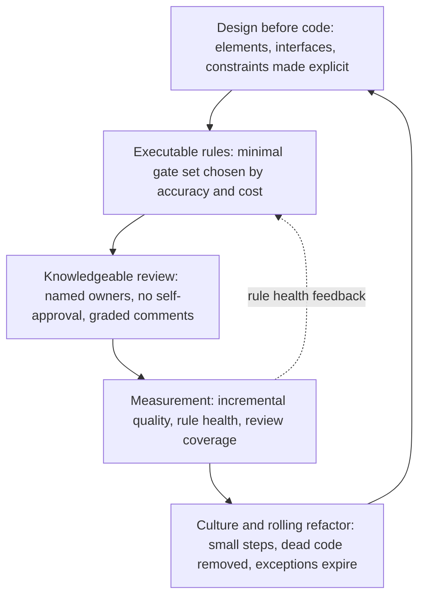

# Architecture quality, clean code and programming-standard methods

Reviewed 2026-11-18. This note reads company-level specification clauses,
governance material and widely published engineering practice as one method for
architecture quality, clean code and programming standards. It is a reading,
not a copy of any specification, not a new mandatory control for a repository,
and not evidence that a particular change is correct. Load-bearing claims carry
an evidence level; see [Evidence levels](#evidence-levels).

## Chinese summary

1. 本文把公司级规范库的条款骨架、组织级治理材料与业界通用实践，整理为可复用的代码架构质量、Clean Code 与编程规范方法，并逐条标注证据级别。
2. 主线是五段闭环：设计先于编码、可执行规则守住底线、懂代码的人做看护、度量与评价形成闭环、文化与滚动重构防止架构腐化。
3. 编程规范方法包含"系统化、易使用、易检查"三要求，"可读、可维护、安全"三目标，强制与建议两级分层，以及稳定的条款编号方式。
4. 架构质量方法把 4+1 视图转成可核对的建模规则，并给出看护角色、评审准入准出与依赖治理；Clean Code 方法给出七特征、特征权衡与检视清单。
5. 公司级软件工程治理组织的材料是主要依据之一；全文已脱敏，不含内网地址、文档编号、组织代号、人名工号与未公开数值。

## Scope

Use this note when a repository wants to move from "we have a coding standard"
to "we can show which requirement produced which check, and who owns the result
that the check cannot decide". Typical triggers: adopting a gate, defining a
project rule pack, preparing an architecture review, or explaining why a
finding is a signal rather than a verdict.

| Reader | What this note is for |
| --- | --- |
| Architect | Turn architecture description into clauses that can be checked or reviewed, and choose the few dependency rules worth enforcing. |
| Developer | Know what a gate will decide, what it will not decide, and what to write down when the code must deviate. |
| Reviewer | Run a repeatable checklist, grade comments, and close them instead of reopening the same debate. |
| Quality engineer | Separate minimal gate rules from recommended rules, and keep the rule set itself under review. |

In scope:

- the shape of a programming standard: goals, tiers, clause identity, appendix
  templates, and the split between new and legacy code;
- clean-code characteristics, their trade-offs, and the review checklist that
  makes them observable;
- architecture description as clauses, the guardianship roles around it, and
  dependency governance as a declared artifact;
- gates, measurement, rule-set health, and exception handling.

Out of scope:

- reproducing specification text, clause numbers, thresholds or rule tables;
  none of that was available for reading, and copying it would misrepresent
  both the source and this note;
- judging whether a specific change is functionally correct, secure or
  performant. Those need tests, analysis, benchmarks or human design review;
- scoring individuals. Every measurement below is a team or artifact measure
  unless a material explicitly says otherwise, and even then the sample must be
  blind and the result must not be used as a ranking. [E3]

## Evidence levels

The company material used here was reachable at three depths only. The levels
below encode that limit, so a later editor cannot quietly upgrade a phrase into
a requirement.

| Level | What it means here | What it can support | What it cannot support |
| --- | --- | --- | --- |
| E1 | Clause title or clause skeleton published in a company-level specification, including its tier marker and section position. | That a requirement exists, how it is named, how it is grouped, and which artifact it governs. | The full acceptance criteria, thresholds, examples or exceptions inside the clause. |
| E2 | Document introduction text, an organisational notice body, or a governance resolution. | Intent, scope, roles, sequencing, and stated selection criteria. | Company-wide mandatory force, or a numeric threshold that the text did not state. |
| E3 | Widely published engineering practice, or this repository's own inference from the two levels above. | A concrete mechanism, a default, or an implementation order. | Any claim that the company requires it, or that a tool result proves quality. |

[E1]: #evidence-levels
[E2]: #evidence-levels
[E3]: #evidence-levels

Three rules follow, and they are the reason this note is usable at all:

- Every load-bearing claim ends with its level. A claim without a level is a
  proposal, not a finding.
- Paraphrase does not raise a level. "The title says the clause exists" stays
  E1 even when the surrounding prose sounds normative.
- A title-level claim establishes existence and vocabulary, not acceptance
  criteria. Where a mechanism needs a number, this note uses a range or a
  qualitative statement and says so.

## The five-part method

The reviewed material converges on one chain rather than on a longer list.
Quality is placed in four locations: written into a standard so it can be read,
compressed into a rule so it can be checked, bound to a role so it can be
owned, and reflected in an evaluation so it can be sustained. The chain and its
ordering are this note's synthesis [E3]; each element is separately sourced.

Reading the diagram:

- **Design precedes code.** A design record identifies the elements, their
  relations and the constraints before implementation starts; "start typing
  when the task arrives" is treated as the defect, not as speed. [E2]
- **Rules hold the floor, not the ceiling.** A rule can only be trusted for the
  class of problem it detects deterministically. Everything semantic stays with
  a reviewer, and the tool must say so rather than approximate silently. [E3]
- **People own what tools cannot see.** Responsibility areas, a qualified
  reviewer role and a named owner per area are what make an unenforceable
  requirement real. [E2]
- **Measurement closes the loop only if it is incremental.** Trends on new code
  avoid the argument about inherited debt; trends on the whole repository
  reward whoever arrived last. [E3]
- **Culture and rolling refactor prevent decay.** Small, frequent improvement
  plus periodic removal of unused code is the maintenance mechanism; a single
  large refactor is not. [E2]

## Programming-standard method

**Three requirements on the standard itself.** A language standard is expected
to be systematic, easy to use and easy to check. "Easy to check" is the
operative one for a gate: a clause that cannot be turned into a deterministic
check needs a different home, usually a review checklist item. [E2]

**Three goals for the code.** The stated goals are readability, maintainability
and security. They are goals for the code, not for the document, and they are
deliberately fewer than the clean-code characteristics below: the standard
governs style and safety, while clean code also speaks about testability,
efficiency and portability. [E2]

**Two tiers, redundantly marked.** Clauses carry a tier marker in their
identifier and a matching modal verb in the title: mandatory language for the
upper tier, recommendation language for the lower one. Using both markers as a
mutual check is our convention [E3]; the two-tier split itself is visible in
the published clause set [E1]. The practical consequence is that a rule pack
can enable the upper tier everywhere and the lower tier by team decision,
without inventing a third tier.

**Stable clause identity.** A clause identifier is composed of a tier, a
semantic domain and an ordinal inside that domain; the domain vocabulary covers
naming, comments, formatting, constants, types, control flow, expressions,
functions, generics, error handling, modules, macros, unsafe code, foreign
interfaces, concurrency, asynchronous code and memory. The exact spelling is
deliberately not reproduced here. [E1]

Two properties matter more than the spelling [E3]:

- the identifier is stable across revisions, so a rule, a suppression and a
  review comment can all point at the same clause;
- the domain token is semantic, so coverage can be reported per domain instead
  of per document section.

**Fixed document skeleton.** Overview (background, goal and scope, overall
principles, how clauses are organised), code style (naming, formatting and
comments), programming practice (constants, types, expressions and control
flow, functions, generics, error handling, modules, macros), safety practice
(unsafe code, foreign interfaces, concurrency, memory), and appendices. [E1]

**Appendices carry executable templates.** The appendices provide a formatter
configuration template and a static-analysis configuration template, so the
"clause to configuration" step is published rather than left to each team.
[E1] This is the cheapest available bridge between a standard and a gate, and
it is the part most often dropped when a standard is copied.

**Cross-reference to clean code.** Each language standard carries a mapping
from its clauses to the clean-code characteristics, which is what makes
"coverage per characteristic" a computable statement instead of an opinion.
[E1] The mapping is a table, so it also exposes domains with no clauses at all.

**Maturity levels.** Clean code is described through a three-level model (L1
to L3), and the highest level is backed by objective architecture metrics rather
than by self-assessment. [E2] Levels are useful as a planning device and
dangerous as a label: a level says which practices a team has adopted, not how
good an individual is. [E3]

**New code strict, legacy code progressive.** The published structure separates
the strategy for new code from the strategy for existing code, and that split
matches the governance position that new code must arrive clean while history
is improved deliberately. [E1] Our application of that split:

- a new file, and any file touched by a change, must satisfy the current tier;
- an untouched legacy file is not rewritten to satisfy a new rule; it is
  scheduled, or it is registered as debt with an owner;
- a "clean the file while you are there" change stays inside the same review,
  so the behavioural diff remains reviewable. [E3]

## Clean-code method

**Consensus before constraint.** The stated first purpose of a clean-code
programme is to agree what good code means and why it matters; the constraint
follows. A gate introduced before that agreement produces suppressions rather
than clean code. [E2]

**Seven characteristics.** The characteristic set is readability,
maintainability, security, reliability, testability, efficiency and
portability. [E1] What each one asks of a change, and the cheapest honest
signal available in a repository, are our reading [E3]:

| Characteristic | What it asks | Cheap honest signal | What it does not prove |
| --- | --- | --- | --- |
| Readability | A reader can follow intent without the author present. | Naming, size, nesting and comment checks on changed entities. | That the intent is correct. |
| Maintainability | Change stays local and does not copy knowledge. | Duplicate blocks, module boundaries, dependency edges. | That the design is the simplest one. |
| Security | Untrusted input, secrets and authority are handled explicitly. | Secret patterns, dangerous API use, suppression review. | Absence of a vulnerability. |
| Reliability | Failure paths exist and recover. | Error-handling structure, retry and timeout presence. | That recovery works under load. |
| Testability | Behaviour can be observed without the whole system. | Paired tests, naming, deterministic fixtures. | Coverage of the risky branches. |
| Efficiency | Work is bounded in time and memory. | Complexity proxies, allocation and loop shape. | Any performance claim without a benchmark. |
| Portability | Platform assumptions are isolated. | Hardcoded paths, platform-specific calls, build conditionals. | That the port actually works. |

**Characteristics trade off.** The material explicitly separates a discussion
of trade-offs from the descriptions, which is the honest position: a change can
improve readability at the cost of efficiency, or improve portability at the
cost of simplicity. [E1] Our rule for a review: name the two characteristics in
conflict, state which one the context favours, and record the choice in the
review comment. A reviewer who demands all seven at maximum is asking for a
change that cannot exist. [E3]

**Two perspectives, not one standard.** Delivered code is split into framework
code and use-case code; the framework set is the seven characteristics above,
while use-case code replaces testability with effectiveness, because a test
case is judged by whether it detects what it claims to detect. [E1] The
practical consequence is that "the tests must be clean too" is not the same
requirement as "the product code must be clean", and a rule pack should not
apply one profile to both trees. [E3]

**Review checklist.** Nine items, used as written rather than as a memory aid.
[E2]

| # | Item | What a reviewer must be able to answer |
| --- | --- | --- |
| 1 | Functional correctness | Does the change implement the requirement or fix the defect; are boundary and error cases present; is the logic followable? |
| 2 | Basic programming standard | Are names, structure, length, comments and style consistent with the adopted standard? |
| 3 | Reliability | Are resources released; can exceptions and deadlocks recover; are messages retried; is there a degraded mode under resource pressure? |
| 4 | Security | Injection paths, plaintext credentials, sensitive data in logs, unencrypted sensitive fields. |
| 5 | Performance | Avoidable branching, looping and allocation; is the algorithm appropriate for the volume? |
| 6 | Maintainability | Duplicated functions and blocks; are logs complete, and are key events auditable? |
| 7 | Test coverage | Are unit, developer and integration tests present; do they cover main, boundary and error paths; do automated suites pass? |
| 8 | Compatibility | Is a new external component necessary; does it affect upgrade, API or backward compatibility; are there version or platform dependencies? |
| 9 | Other | Does it meet the platform's uniformity requirements, and is the change description complete? |

**Smells and refactor triggers.** A smell is a maintainability signal, not a
violation. The material keeps a separate guide for identifying, registering and
disposing of smells, which is the right shape: detection, ledger, action. [E1]
Triggers we use, all of them review-level [E3]:

- a change adds a third copy of a block before anyone has looked for a shared
  home;
- a function needs a comment to explain what its name already should;
- a fix requires reading four files that the change description did not name;
- a conditional grows a new branch for every new caller;
- a temporary workaround survives its tracking item;
- a file is edited only to keep it compiling.

**Comment grading and closure.** Review comments are structured, carry a
severity, a root-cause statement and a classification, and every comment must
be closed before merge, or bound to a tracked requirement or defect. [E2] The
classification enumeration itself was not available, so this note does not
invent one; a repository must publish its own closed list, otherwise the
severity field degenerates into a sentiment. [E3] Two working rules follow:
"blocking" means the change cannot merge, "non-blocking" means a follow-up item
must exist before merge, and a comment with neither is advice that the author
may decline - which is acceptable, as long as the decline is written down.

## Architecture-quality method

Architecture quality in the reviewed material is not a review meeting; it is a
modelling specification whose clauses name what must be described, plus a role
that keeps the description true. That is what makes part of it checkable. [E1]

**The five views and what each must carry.** [E1] The third column is our
reading of how a description becomes checkable; the first two columns follow
the published view and clause titles.

| View | Must describe | Checkable anchor |
| --- | --- | --- |
| Use case | Actors and the services the system offers them. | Each declared service reaches at least one use case. |
| Logical | Elements, their relations, provided and required interfaces, and the architecture constraints in force. | Element and interface sets are enumerable; constraints exist as objects, not prose. |
| Development | How logical elements map onto repositories and directories, plus build constraints. | Every self-developed logical element names a repository and a directory. |
| Run time | Processes, and the correspondence between processes, deployment units and elements. | Each deployment unit names the processes it starts. |
| Deployment | Nodes, node relations, the real delivery model and the real deployment model. | Both models exist and are distinguishable. |

**Modelling rules that turn description into review material.** [E1] The
second column states the failure each rule removes, which is our phrasing.

| Rule | What it prevents |
| --- | --- |
| Model relations, not only boxes. | A diagram that cannot express coupling. |
| Give every interface a direction: provided or required, and attach it to at least one element. | Contracts that exist only in a slide title. |
| Model architecture constraints explicitly. | Constraints that live in a reviewer's memory and vanish on rotation. |
| Map every self-developed logical element to a repository and a directory. | An architecture that cannot be located in code. |
| Do not create new logical elements in the development view; reference them. | Two architectures that drift apart. |
| Keep modelling at component or service granularity, not coarser. | Element lists too abstract to compare with code. |
| Do not nest components inside components (recommended tier). | Unbounded hierarchy that no one reviews. |
| Record technology selection with version, rationale and the constraints it introduces. | Silent framework choices that become architecture. |
| Model the build environment and the build constraints as architecture decisions. | Build rules that contradict the described architecture. |

**Guardianship.** Design authority, review authority, repository control and
area ownership are held separately in the material, and that separation is what
keeps a gate from being both judge and defendant. [E2] Grouping them into the
four roles below is our reading [E3].

| Role | Owns | Does not own |
| --- | --- | --- |
| Area owner (responsibility area) | The area's architecture quality and technical debt; identifies, registers, orders and repays debt. | Individual performance judgement. |
| Qualified reviewer (committer-equivalent) | Architecture and core-code review, acceptance or refusal of a change. | Tool configuration. |
| Repository administrator | Gate and configuration compliance, area boundaries, permissions. | Design decisions inside an area. |
| Review board | Exceptions, cross-area conflicts, public interface changes. | Routine per-change review. |

**Exceptions are filed, never implied.** A deviation from a gate or a branch
protection rule requires review and a record; an unfiled deviation is treated
as a breach rather than as pragmatism. [E2] A filing is useful only if it names
the rule, the scope, the reason, the owner and the expiry condition. [E3] An
exception with no expiry is a permanent policy change made by accident.

**Architecture review: inputs, outputs, entry and exit.** Our operating
definition [E3], built on the review and design obligations in the material
[E2]:

- inputs: the change's design record, the affected views, the constraint list,
  the dependency delta, and the threat or risk note where the material requires
  one;
- outputs: a decision (accept, accept with conditions, reject), the conditions
  as tracked items, and any update to the architecture description;
- entry criteria: the design record exists and the affected elements,
  interfaces and constraints are named; a change without that record is not
  reviewable;
- exit criteria: every condition has an owner and a close condition, and the
  description matches the decision.

**Dependency and coupling governance.** The material states the goal - keep
dependencies inside declared boundaries and prevent decay - but publishes no
rule-level dependency matrix. [E2] Everything below is therefore E3, and a
repository that adopts it must publish its own edges rather than inherit ours:

- reverse dependency: a lower layer must not import a higher one;
- cross-layer call: a layer may use only its declared neighbours;
- dependency cycle: no cycle across modules of one deployable unit;
- boundary leakage: types from an internal package must not appear in a public
  signature;
- unresolved edges: an import that matches no declared edge is reported as
  undeclared, not as allowed.

The repository supplies its own boundary patterns. When a required check
encounters an in-scope changed import in a language with neither declared nor
forbidden patterns, it reports incomplete and identifies the language. [E3]

## Gates and measurement

**Two rule sets.** A minimal set and a recommended set are separate artifacts.
The minimal set is the subset that is accurate enough and fast enough to block
a change; it is bound to both the merge gate and the release gate, so the same
rule set is applied at two points rather than one. [E1] A recommended set is
advisory, may be adopted per team, and is the natural place for rules that are
still being measured. [E2]

**Selection criteria.** A rule enters the minimal set on two grounds: how often
it is right, and what it costs to run. Importance alone is not a criterion,
which is why an important-but-noisy rule belongs in the recommended set. [E1]

**Tiered deployment and maturity.** Different teams and scenarios deploy
different check strength, and the check system carries a maturity assessment so
a team can locate itself instead of comparing raw finding counts. [E2]

**Human gates, expressed as ranges.** The material states both numbers and
qualitative intent; the numbers are internal planning parameters, so this note
keeps only the shape. [E2]

- at least two reviewers and one qualified approver; a change must never be
  approved by its author;
- a review request is expected to be answered within the same working day, and
  the material recommends a few review passes per day rather than one long
  session;
- the gate is expected to finish in minutes, and the wait time is itself a
  measured quantity - a slow gate trains people to bypass it;
- incremental coverage is expressed as a floor plus a stretch target rather
  than as one number, and it is computed on changed lines only;
- a change is expected to stay reviewable in one sitting: a few hundred changed
  lines is the usual range, and anything larger should be split or explicitly
  scheduled for a joint review.

The exact thresholds in force at any company are not reproduced here; a
repository must set its own and record why. [E3]

**Rule health is a product, not a chore.** The material treats the rule set as
a maintained asset with named failure modes: redundant findings, high
suppression volume, long fix cycles, duplicated or low-value rules, and false
positives. [E2] The governance loop it implies [E3]:

| Signal | Question it answers | Action it justifies |
| --- | --- | --- |
| Suppression rate per rule | Is the rule wrong, or is the codebase not ready? | Retune, reclassify as advisory, or keep with a migration plan. |
| False-positive share from sampled findings | Can a developer trust a finding? | Fix the pattern, narrow the scope, or retire the rule. |
| Time from finding to fix | Is the gate producing debt? | Move the rule earlier, or reduce its blocking tier. |
| Duplicate or overlapping rules | Are we paying twice for one signal? | Merge or retire. |
| Feedback volume and closure | Is anyone listening? | Publish a response commitment and a closure state. |
| Defect-dictionary benchmark regression | Did a rule change lose a known defect? | Block the change until the regression is explained. |

**Suppression and exception are different acts.** A suppression says "this
occurrence is not the defect this rule looks for"; it needs a category and a
reason. An exception says "this rule does not apply to this scope"; it needs a
record, an owner and an expiry. [E2] Collapsing the two produces a repository
where nothing can be concluded from a green gate. [E3]

**Measurement discipline.** Three constraints keep metrics from becoming
theatre [E3]:

- measure new code, and state the window; a whole-repository average moves too
  slowly to attribute anything;
- sample blind when evaluating quality, and prefer quality of findings over
  count of findings [E2];
- never rank individuals by finding counts, review counts or lines; the
  material's own evaluation is sample-based and quality-weighted, which is only
  meaningful if it stays that way. [E2]

## Mapping to this repository

The candidate list is drawn from the reviewed methods and filtered to what this
CLI can make decidable today. Priority reflects adoption order, not severity:
P0 is safe to enable first, P1 needs a declaration from the repository, P2 needs
an external report or platform data, P3 is a declared capability gap.

Capability vocabulary used below:

- `import-boundary`: declared and forbidden import patterns per language,
  expressed as bounded regular expressions. The rule is disabled by default.
- `count` / `text` / `marker` / `required-path`: bounded assertion families
  over selected entities;
- `tree-sitter`: parsed entities, so structure rather than raw text is asserted;
- `external report`: normalized analyzer output, filtered to the change;
- `snapshot`: the immutable input every result is bound to;
- `gap`: no evidence source exists today; the honest result is incomplete.

| Check | Type | Pri | Current capability | Evidence |
| --- | --- | --- | --- | --- |
| Forbidden cross-layer or cross-module import | Architecture | P0 | `import-boundary` gives `forbidden_imports` precedence. With `declared_imports`, unmatched imports are reported by default. | E3 |
| Design record attached to a change | Architecture | P1 | `required-path` plus a path convention | E2 |
| Design record names solution, test focus and impact analysis | Architecture | P2 | `text` heading assertions | E2 |
| Logical element mapped to repository and directory | Architecture | P1 | `required-path` plus an element inventory | E1 |
| Development view redefines a logical element | Architecture | P3 | `gap`: needs structured model comparison | E1 |
| Interface bound to at least one element, with direction | Architecture | P3 | `gap`: needs model input | E1 |
| Architecture constraint modelled as an object | Architecture | P3 | `gap`: review evidence only | E1 |
| Technology selection recorded with version and rationale | Architecture | P2 | `text` plus dependency manifest assertion | E1 |
| Public interface change carries a review record | Architecture | P2 | `marker` or Git trailer binding; proves a record exists, not that it was approved | E2 |
| Dependency cycle or reverse dependency | Architecture | P3 | `gap`: needs graph analysis | E3 |
| Language allow-list for new source files | Architecture | P1 | file extension and path assertions | E2 |
| Naming follows the language standard | Readability | P1 | `tree-sitter` naming assertions | E1 |
| Over-long file | Readability | P0 | `count` over snapshot files | E1 |
| Over-long function | Readability | P2 | `tree-sitter` entity plus line count; approximate | E1 |
| Duplicated function or block | Readability | P3 | `gap`: needs cross-file similarity | E1 |
| Exported interface has a usable comment | Readability | P2 | `tree-sitter` entity plus comment assertion | E1 |
| Comment contradicts the signature | Readability | P3 | bounded approximation: documented parameter names versus parameters | E1 |
| Commented-out code left in place | Readability | P1 | source-pattern rules already shipped for two languages | E3 |
| Formatter configuration present | Readability | P0 | `required-path` | E1 |
| Magic numbers and hardcoded constants | Readability | P2 | literal assertion excluding conventional values | E3 |
| Code-class binaries committed | Engineering | P0 | path and extension assertion | E2 |
| Oversized file committed | Engineering | P0 | file size assertion | E2 |
| Change subject follows the agreed structure | Engineering | P0 | commit-message rules | E2 |
| Change stays within a reviewable size | Engineering | P0 | diff-size budget | E2 |
| New source file has a paired test | Engineering | P1 | path pairing assertion | E2 |
| Temporary workaround or TODO bound to a tracking item | Engineering | P1 | marker rule plus binding assertion | E2 |
| Change introduces no new high-severity finding | Engineering | P2 | `external report` plus incremental filter | E2 |
| Incremental coverage floor on changed lines | Metric | P2 | `external report` normalization | E2 |
| Suppression carries a category and a reason | Metric | P2 | marker binding assertion | E2 |
| Exception has a filed record and an expiry | Metric | P2 | `required-path` plus marker binding | E2 |
| Review satisfaction: at least two reviewers, no self-approval | Metric | P2 | platform data, or a policy consistency check | E2 |
| Enabled rules contain the minimal set | Metric | P3 | configuration containment check | E1 |

What this table deliberately omits: anything requiring data-flow, symbol
resolution, cross-file similarity or an architecture model parser. Those are
the rows marked `gap`, and the correct behaviour is to report incomplete rather
than to approximate with a pattern and call it evidence. [E3]

## Anti-patterns

Each row is a failure this note has seen or can derive from the material; the
correction is the smallest step that restores meaning. [E3]

| Anti-pattern | Symptom | Consequence | Correction |
| --- | --- | --- | --- |
| Architecture by slide | Boundaries live in a deck; no repository rule names them | The first urgent change crosses every layer, and no one can say it was wrong | Publish the forbidden edges, then let the check execute only what is published |
| Two architectures | The development view introduces elements that the logical view does not contain | Code and design drift; reviews argue about which one is real | Reference elements instead of recreating them; treat a new element as a design change |
| Gate as a wall | Findings arrive with no owner, no fix and no category | Developers suppress rather than read, and the gate teaches nothing | Grade findings, publish the fix, and keep only accurate rules in the blocking tier |
| Suppression as habit | Blanket suppressions with an empty reason | Suppression rate rises, and the rule's real precision becomes unknown | Require a category and a reason; review the suppression ledger as a rule-health input |
| Self-approval | The author is also the approver, or the second reviewer is nominal | Review becomes a formality and defects pass unread | Require a non-author approver and record who reviewed what |
| Mega change | One change mixes a refactor, a feature and a dependency bump | Nothing can be reviewed line by line, and reverting loses unrelated work | Split by intent; schedule a joint review when the split is genuinely impossible |
| Threshold theatre | A number is adopted because a document had one, with no owner | The number is either gamed or ignored, and the underlying problem returns | Choose the threshold with the team that must live with it, and record the rationale |
| Comment coverage by volume | Every function gets a comment restating its name | Noise hides the few comments that carry intent | Require comments where intent, constraint or non-obvious reason exists |
| Tool-shaped clean code | A scanner is bought and the programme is declared complete | The decidable subset improves while design and review decay | Keep the human gates and the architecture description in the same programme |
| Permanent exception | A waiver has no expiry and no owner | The exception becomes the policy, and the gate loses authority | Every exception names an owner and an expiry condition; expiry is a review event |
| Ranking by findings | Teams are compared by finding count or fix speed | Suppression and under-reporting become rational | Report per-area trends against the area's own baseline, never as a league table |
| Big-bang refactor | Refactoring is deferred into one large branch | Merge risk grows and the branch is abandoned or force-merged | Micro-refactors inside normal changes; architecture-scale work as its own scoped effort |
| Untested clean-up | Dead code is removed without a test that behaviour is unchanged | A silent behaviour change is attributed to the refactor | Remove only what is provably unused, with the check that proves it |
| Rule sprawl | Overlapping rules accumulate because adding is easier than retiring | Duplicate findings, unclear ownership, rising suppression | Treat rule retirement as a normal change with a migration note |

## Rollout

**New project, in order.** The order matters because each step produces the
input for the next. [E3]

1. Write the design record: elements, relations, provided and required
   interfaces, constraints, technology selections.
2. Map every self-developed element to a repository and a directory, so the
   description is locatable.
3. Declare the forbidden dependency edges, and enable the boundary check with
   only those edges.
4. Adopt the formatter configuration from the standard's appendix, so style
   stops consuming review attention.
5. Enable the minimal gate set: subject structure, change size, binary and size
   limits, paired tests, workaround binding.
6. Name the area owners and the qualified reviewers; require two reviewers and
   no self-approval.
7. Add measurement last: changed-line coverage, suppression ledger, rule
   precision sampling. Measuring before the above exists measures noise.

**Legacy project, in order.** [E3]

1. Take a baseline snapshot and record the current numbers without judging
   them; this becomes the reference for "no worse".
2. Apply the strict tier to new and touched code only; do not rewrite untouched
   files.
3. Start the suppression ledger immediately, with categories, so inherited debt
   and rule defects are distinguishable.
4. Set an improvement budget per area, expressed as scoped work with an owner,
   not as a global percentage target.
5. Add the minimal gate set, keeping each rule's blocking tier justified by its
   measured precision.
6. Widen scope only when the suppression ledger stops growing and the area
   owner agrees; widening by decree recreates the debt elsewhere.

**Thirty, sixty, ninety days.** Phases, not dates. [E3]

| Phase | Focus | Exit condition |
| --- | --- | --- |
| First 30 days | Inventory and vocabulary: design record, area map, rule inventory, current measurements | The repository can state which rule came from which requirement, and who owns each area |
| Next 30 days | Enforcement on new code: formatter, minimal gate set, review roles, exception ledger | New changes pass without manual waivers, and every waiver is filed |
| Following 30 days | Loop closure: rule precision sampling, retirement of low-value rules, first debt repayment in the worst area | The suppression ledger has stopped growing and at least one rule has been retired or retuned |

## Sources and evidence grading

The material behind this note falls into four classes. None of them was
available at full-text depth, and the note is written to that limit.

| Source class | What was reachable | Level available | When read |
| --- | --- | --- | --- |
| Company-level specification library | Metadata, introduction text, complete clause skeleton and clause titles for a subset; no paragraph body | E1 (titles), E2 (introductions) | 2026-11-18 |
| Company-level governance resolution | Resolution summary: asset list, ownership, closure-to-operation model | E2 | 2026-11-18 |
| Organisational notices and management requirements | Full body text for a code-review practice, a quality red-line list, a language-selection requirement, a responsibility-role requirement | E2 | 2026-11-18 |
| Internal technical forum and employee community | Search unavailable, or no methodological content in results | None adopted | 2026-11-18 |

Explicitly not obtained, and therefore not asserted anywhere above:

- any specification's paragraph body; the reader in use renders pages as a
  canvas without a text layer, and file download did not complete;
- the gate and release rule table, which lives in an attachment;
- metric definitions and threshold values for complexity, duplication,
  comment density and coverage;
- the architecture dependency matrix, and any clause that enumerates allowed
  or forbidden edges;
- the second-level classification of review comments;
- the defect-dictionary benchmark set and its metadata model;
- a standalone responsibility-evaluation model for the governance body; the
  related requirements exist only inside the resolution.

How to re-verify before changing a rule [E3]:

- confirm the clause still exists at the same identity, and re-read the level
  you are relying on;
- prefer the introduction text over a summary of a summary; a paraphrase two
  steps removed is not evidence;
- if a mechanism has no clause, keep it labelled E3 in this file rather than
  promoting it after the fact;
- record the review date at the top of this file and in the archive index.

## Desensitization

| Removed class | Treatment |
| --- | --- |
| Internal addresses and navigation paths | Absent; sources are described by class and function only. |
| Document numbers, issue numbers and approval identifiers | Absent; no identifier in this file can be resolved to a document. |
| Organisational codes, department and product-line names | Replaced by role or level: company-level, organisational, area, review board. |
| Personal names, accounts and employee identifiers | Absent; people appear only as roles. |
| Project, programme and product codenames | Absent; mechanisms are described, never named. |
| Versions and release identifiers of internal documents | Absent; the note is dated, not version-pinned. |
| Unpublished metrics, thresholds and improvement percentages | Absent; replaced by ranges, qualitative shapes or an explicit statement that the number is omitted. |
| Clause text and clause numbering | Not copied; identifiers are described structurally, without their spelling. |
| Platform and tool names | Generalised to function: code host, review platform, check service, defect dictionary. |

Residual risk. The method structure in this note - five-part chain,
thirty-two mapping rows (eleven architecture, nine readability, seven
engineering, five metric), fourteen anti-patterns - is this note's own
organisation, not the outline of any single document. A reader who needs the
normative text must go to the specification, and a reader who needs a rule must
go to the repository's declared policy. [E3]

## Keeping this note honest

- A new claim needs a level before it needs a sentence.
- A number needs a public source, or it stays a range. Internal planning
  parameters are not published here, even when they are easy to remember.
- When a specification is revised, recheck the clause identities first; a
  renamed clause silently orphans every rule that pointed at it.
- When a rule is retired, say so here as well as in the policy; a mapping table
  that only grows is a mapping table no one trusts.
- The machine-readable side of this archive is
  [the source registry](../registry.yaml); see also
  [clean code and executable contracts](clean-contracts.md),
  [the architecture concern](../concerns/architecture.md) and
  [the lifecycle rulebook](lifecycle-rulebook.md).
