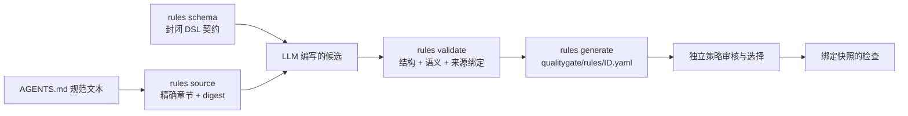
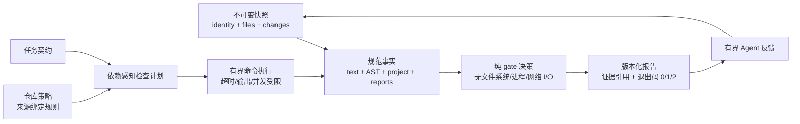

# 质量不是"测试通过"，而是"证据到门禁"——qualitygate-cli 的质量护栏理念

> 面向开发者、CI 和编程 Agent 的仓库质量与任务验收门禁。本文解释它背后的质量护栏理念。

## 从四个反直觉的事实说起

AI 编码已经把"改出能通过测试的代码"变成常态，但"通过测试"从来不是交付的全部。

第一个事实来自 SWE-CC 基准（[Correct Code, Broken Contributions?](https://arxiv.org/abs/2610.06193v1)）：12 个开源仓库、500 道 SWE-bench 派生任务、8000 次运行中，Native 条件下适用且可判定的规则合规率平均约 56.9%，也就是约 43.1% 的规则判定被判违反；更值得注意的是，在**功能已经通过**的运行里，违规约一半发生在最终提交之前的轨迹中——"补丁是对的，贡献是坏的"。

第二个事实来自维护研究。[《Who Finishes the Job?》](https://arxiv.org/abs/2609.26847v2)追踪已合并的 Agent PR，在 30 天观测窗口内 4.5% 被核验出后续修复，与同期人类 PR 相比后续修复 odds 约为 1.62 倍；[《Do Modifications Made by Coding Agents Make Subsequent Software Maintenance Harder?》](https://arxiv.org/abs/2610.14768v1)（SWE-Maintain）的三事件维护链实验里，继承 Agent 历史时"事件解决且此前测试全通过"的成功率比继承开发者历史低 14.0 个百分点。合并不是维护生命周期的终点。

第三个事实关于**验收速度**。AI 让"写代码"大幅提速，下游验收却没有同比例加速。[Demirer、Musolff 与 Yang 的代际工具研究](https://www.mertdemirer.com/Papers/Demirer_Writing_vs_shipping_code.pdf)（超过 50 万 GitHub 开发者）观察到，sync agent 的代码行增加约 +958%、PR 增加 +86%，而 release 只增加 +19.8%——产出沿"代码 → commit → PR → release"逐层衰减，写代码的收益在到达交付环节前大幅缩水；commit 的代际累计增幅从 autocomplete 的约 +30% 一路扩大到 async agent 的约 +240%，四个软件市场的新应用供给也在加速，但新应用队列的早期使用量并未同步增长。另一项企业纵向研究干脆把标题写成了 [AI Writes Faster Than Humans Can Review](https://arxiv.org/abs/2607.01904v1)。[METR 2026 的自报调查](https://metr.org/blog/2026-05-11-ai-usage-survey/)同样呈现速度与价值的分离：速度中位数约 3 倍，价值中位数只有 1.4–2 倍。产出端在加速、验收端在排队，瓶颈从"能不能写出来"转移到"能不能审完、能不能交付"——这正是质量护栏要解决的问题：把验收从人肉瓶颈变成可自动化的、有证据的检查。

第四个事实关于**弱约束本身**。仓库里的大部分质量规则——`AGENTS.md`、PR 模板、贡献文档里的条款——是自然语言：它们表达了意图，却不可执行、无证据、无法在 CI 或 Agent 流程里自动判定。SWE-CC 的实验量化了这个鸿沟：在所有组都已被提示先看规则的情况下，Native 条件下 Agent 自发尝试读取规则的比例只有 28.9%，实际取回规则文本的只有 12.6%；而把抽取后的规则汇入本地 Markdown 文件并指示阅读后，合规率平均提升约 8.75 个百分点——"规则存在"和"规则被执行"是两回事。更麻烦的是，弱约束难以机械化：823 条规则里有 304 条在全部 8000 次运行中从未触发，代码质量类约 27%、测试类约 64% 的触发项可评分；即使编译成检查器，两位评审对 150 条样本的判定一致性为 94.0%，按仓库加权估计仍有约 12.8% 的检查器不被接受——把自然语言翻译成确定性程序本身就有解释取舍。弱约束的代价最终落在人身上：规则靠人肉 review 把关，Agent 在看不见规则的"无约束状态"下飞行，规则随文档漂移而失效。

这四组事实指向同一个结论：在 AI 生成代码、AI 评审、AI 修复都成为常态的时代，"谁来验收"和"如何验收"成了新的瓶颈。补丁正确性、过程合规、未来可维护性，是三件不同的事，需要三种不同的证据；而过程合规最难的地方，恰恰在于仓库里的大多数约束是弱约束——自然语言、不可执行、无证据。qualitygate-cli 把这件事做成一门"质量护栏"：它不直接产出更高质量的代码——写代码的不是它——它守住的是验收的门，让每一条交付结论都绑定可复验的证据，没有证据的"通过"不算通过。本文先讲护栏理念的五条原则，再讲它的核心设计思想：如何把 `AGENTS.md` 等仓库规范里的"弱约束"变成基于规则的程序化约束，以及这套规则引擎到底有哪些能力。

## 质量护栏的五条第一性原理

### 1. 证据绑定输入：输入变了，结论作废

质量结论必须绑定三个输入：被检查的快照、仓库策略、任务契约。快照身份以及策略/任务摘要进入每个计划和报告；接受结果前，应用层会确认产出证据属于同一个物化快照。源码变化、Git 对象缺失、路径无效或报告身份不匹配，都会使受影响检查失效。

这是对"一次通过，永久有效"的直接否定：输入变化后，不能沿用旧的通过结论。

### 2. 违规与未完成是两种状态

qualitygate 用三个退出码区分结局：`0` 完整通过，`1` 阻塞违规，`2` 验证未完成。缺失报告、超时、能力不足都会保留为验证缺口，而不是折算成通过。

这与三项一手研究的状态设计一致：

- [SWE-CC](https://arxiv.org/abs/2610.06193v1) 的 `withheld` 表示规则被触发但证据不足，**不可算通过或违反**；
- [Google AQuA](https://developers.googleblog.com/the-outer-loop-insights-first-an-ambient-quality-agent-that-diagnoses-your-production-agent/) 的源码把超过复核上限、没有轨迹、复核失败的候选保留为 `UNJUDGED`，而不是记成干净通过；
- [AgInt](https://arxiv.org/abs/2610.23996v1) 证据证书的 `open` 表示尚无赋级记录，不表示对象不存在。

### 3. 渐进证据强度，禁止静默降级

证据强度是分层的：文本/diff 信号 → tree-sitter AST 结构实体 → 项目/编译器/原生 lint 事实。更强事实缺失时，**不能静默降级为较弱事实**。语法树不等于类型解析或数据流知识；报告适配器归一化现有工具的输出，但不声称源格式未提供的语义。

[Groundability 研究](https://arxiv.org/abs/2610.01023v1)给出了同样的警告：把证据结构化能降低阅读负担，却不能独自解决其内容真假。保持证据来源身份，是防止摘要逐级加工后被误认为已验证事实的关键。

### 4. 规则与工具统一在一个门禁

质量护栏不是又一个 linter，而是把三类东西合并进同一个检查计划：

1. 内置规则（如行尾换行符）；
2. 从 `AGENTS.md` 等仓库规范提取的、来源绑定到具体文件/行的项目规则；
3. 项目已有的 lint、测试、覆盖率工具的归一化报告。

[SWE-CC](https://arxiv.org/abs/2610.06193v1)展示了这条路的价值：把 12 个仓库的贡献规范拆成 1759 个原子条款，最终编译成 823 个可执行检查器——"项目规则原文 → 适用前提 → 可执行检查 → 证据位置 → 验收"是一份可版本化的工程资产。但研究本身也提醒：把自然语言规则变成确定性程序仍包含解释取舍，approximate 检查"确定性执行"不自动等于语义正确。所以 qualitygate 的规则配置强调严格加载与人工审核，而不是让 Agent 自行抽取后自动生效。

### 5. Agent 反馈是有界内循环，最终回到同一流程

给 Agent 的反馈只是**有界投影**，不是第二套决策引擎：开发/编辑阶段是一个快速内循环——quick 检查给出诊断与复验参数，Agent 据此修复后再次反馈，循环受次数与耗时预算约束，不能关闭必需规则、降低严重级别、替换受信策略或伪造人工批准；交付前退出内循环，对实际组合后的最终快照执行**无路径过滤的 full 检查**，复验重新进入相同的获取、计划、执行与决策流程。

这对应 [AI-to-AI 评审研究](https://doi.org/10.4230/LIPIcs.ESEM.2026.75)的工程建议：评审意见要接上有门槛的反馈闭环，每条意见保留定位、证据、置信度与后续决定；把"作者采纳"当真阳性，会把误报驱动的无益修改计作收益。也对应自适应数据分析的留出集原则（[The Reusable Holdout](https://research.google/blog/the-reusable-holdout-preserving-validity-in-adaptive-data-analysis/)）：冻结候选、独立确认、防止自反复盘冒充完整验证。

## 设计思想：把弱约束变成程序化约束

qualitygate-cli 对"弱约束"的定义很直接：`AGENTS.md`、PR 模板、贡献文档里的自然语言条款——它们表达了意图，但不可执行、无证据、无法在 CI 或 Agent 流程里自动判定。设计思想不是"用 AI 理解自然语言"，而是**把可执行的条款翻译成受 Schema 管理的、带版本的结构化规则**，让 LLM 只做翻译，CLI 做权威。

转化遵循三条原则：

1. **规则是数据，不是 prompt，也不是插件代码**。项目规则由封闭 JSON Schema 管理、带版本号、原子写入 `qualitygate/rules/<id>.yaml`。Schema 校验证明形状，来源绑定确认选中的字节，采用记录表达策略接受；任何一项都不能单独证明翻译充分。
2. **来源绑定优先**。每一条规则候选都从 `rules source` 拿到精确的 document + section + digest，原样复制进候选。LLM 可以提出类型化候选 C，但**不能制造来源绑定 B、不能重定义 Schema S、不能自行宣布校验成功、不能采用规则、不能合成执行证据**——这五步都由匹配版本的 CLI 完成，模型解释永远不会成为运行时 authority。
3. **能表达才表达，不能表达的保留为缺口**。只有有限 DSL 能表达的条款才成为 project-rule 候选；不支持的条款保留为 capability gap，或路由到既有 lint、AST/project adapter、command check、人工决策。条款覆盖（`constraints.coverage.v1`）把每条规范条款映射到检查并记录状态：`unsupported`、`unadopted`、`pending`、`failed`、`verified`、`not_applicable`——"弱约束转程序化"的进度本身可见、可审计。



同一条弱约束，正确表示方式不同（示例引自仓库的规则编写指南）：

| 仓库约束示例 | 正确表示方式 |
| --- | --- |
| "源码、测试、文档和 workflow 文件不超过 1,000 行" | project rule：`file`、`change: all`、限定路径、`max_lines: 1000` |
| "这些 owner 或测试文件必须存在" | 完整文件清单 project rule 加 `required_paths` |
| "禁止从 A 层 import B 层" | 源码 import 足以证明时用解析后的 `import` 规则；否则用带项目事实的 `module-boundary` |
| "依赖必须无环" | 复用架构 lint 或有界 command check；文本正则无法证明图属性 |
| "必须运行 fmt、clippy 和全部测试" | policy command check，不是 project-rule assertion |
| "必须由 reviewer 判断设计质量" | 人工/manual acceptance；不能把判断编造成正则 |

## 规则能力：渐进精度与可组合规则

规则能力围绕**渐进精度架构**组织：使用足以诚实支撑规则的最低成本证据层，并显式披露层级与边界。

```text
L0  快照与文本信号 —— 换行、提交元数据、新增文件/新增行模式
L1  tree-sitter AST 与规范实体 —— 测试、注解、import、注释、范围和 base/head 身份
L2  项目、编译器与原生工具语义 —— 模块、已解析依赖、bytecode usage、lint/report 证据
```

核心契约是**禁止静默回退**：L2 缺失时不能回退到 L1，L1 无法解析时不能回退到 L0；AST 无法解析、必需项目事实或 lint producer 缺失时，检查保持 incomplete。快速文本检查只声明审查信号；声称结构的规则必须消费解析节点，声称依赖语义的规则必须消费生态证据。

实现上分为七类，每类有公开 ID 和封闭集合内的实现 ID（`implementation`），配置层在执行前拒绝未知参数、错误类型、不支持的语言、非法 glob/正则及不安全组合；未知实现或能力缺失绝不会变成空通过：

| 类别 | 典型实现 | 证据来源 |
| --- | --- | --- |
| 快照元数据 | `line-ending`、`commit-message`、`diff-size` | 捕获字节、提交主题、新增行总数 |
| 新增文件文本 | `file-pattern`、`shell-shebang`、`shell-commented-code` | 整个新增文件或 Shell 特定行组 |
| 新增行文本 | `source-pattern` | 只在 diff 新增行匹配经审核的正则 |
| 语法实体 | `test-naming`、`parameterized-tests`、`comment-language`、`ai-code-traceability`、`import-boundary` | tree-sitter 实体及其 base/head 身份 |
| 项目语义 | `test-annotation-dependency`、`used-undeclared`、`module-boundary` | 绑定快照的 Maven/项目事实与编译使用证据 |
| 项目 DSL | 自定义规则协议 v1、v2 lambda 算子表达式 | 有限且经 Schema 校验的实体、文本、marker、文件清单与依赖断言；v2 增加类型化表达式求值 |
| 原生工具 | command check 与报告适配器 | 覆盖率、SARIF、测试、兼容性和 lint 报告 |

这些类别可**组合**成五类可组合机制（文本模式、AST 与项目事实、有界算子、外部检查、Agent 指令）。有界算子（`rules.operators.v2`）是最接近"编程"的一层：表达式用 `bool/number/string/field/entities`、`and/or/not`、`all/any/filter/count`、`compare/in/matches` 组合已有事实，其中集合操作（`all`、`any`、`filter`）的谓词就是受限的 **lambda 算子**——谓词绑定到集合中的当前实体（`name`、`text`、`path` 三个字段），像匿名函数一样对每个实体求值，但没有任意变量名、外层变量捕获、回调或代码执行；`filter` 返回实体集合，`count` 返回整数，`compare` 只比较同类型标量。完整空集合有明确语义（`all` 为 true、`any` 为 false、`count` 为 0），要拒绝空集合必须显式写计数。嵌套操作共享预算：256 个节点、深度 16、50,000 个实体、100,000 次操作、32 MiB 扫描与 30 秒截止时间，预算耗尽保持未完成。例如测试命名规则先选 AST 实体，再用 `filter` 按 `^test_` 过滤、`count` 要求集合非空、`all` 校验每个名称都符合模式。有界算子组合不能补出缺失事实，也不执行任意代码。每类机制的边界都写死：文本命中只证明文本信号；解析证明结构，语义结论需要对应事实生产者；外部检查退出成功本身不能证明报告完整；Agent 指令的遵守情况需要证据，强制执行需要受支持的宿主入口。

最后一条设计原则是**复用 lint，而不是过度包装**：qualitygate 不重新实现 Clippy、ESLint、golangci-lint、Ruff 等成熟工具，而是以有界 command check 在不可变快照内运行原工具，报告适配器保留其原生 rule ID、位置、版本、完成标志与报告摘要，ratchet 模式比较基线/当前计数，不维护可编辑的"债务文件"。qualitygate 增加的只是单个 lint 通常不负责的编排：Git 快照身份、策略/任务组合、有界执行、报告完整性、跨工具 gate 语义、可复验证据和 Agent 复验反馈。只有需要快照/diff 语义、小型可移植约定、跨语言一致性，或配置工具确实缺少能力时，内置实现才合理。

## 一次 check 的旅程



几个关键设计：

- **不可变交接是核心边界**。后续阶段接收捕获字节和摘要，而不是重新打开开发者可变源码路径的权限；物化过程为项目命令创建一次性目录，命令获得固定 argv、cwd、环境策略、截止时间和预期工件。
- **runner 有界且保留部分证据**。有界缓冲读取 stdout/stderr，终止超时进程树；网络活动只属于远端适配路径，不能作为本地证据的隐式回退；物化检查时 CLI 不修改用户 Git 配置或源仓库。
- **fail-closed 是架构契约**。工具不可用、超时、报告超大、解析错误、冲突、符号链接逃逸或不支持的文件形态，都不能被转换成成功的空结果。
- **quick 与 full 使用同一时序**。profile 只改变计划，不改变证据含义；quick 报告携带所省略的检查清单，复验则捕获新快照，而不是把旧证据附着到新字节上。

## 为什么这些原则经得起证据检验

每一条设计都对应一项可验证的失败模式——把"设计点 → 一手证据 → 设计回应"放在同一张表里：

| 设计点 | 一手证据 | 设计回应 |
| --- | --- | --- |
| 独立的规则验收面 | [SWE-CC](https://arxiv.org/abs/2610.06193v1)：功能通过仍有约 43.1% 的规则判定违规，违规约一半发生在最终提交前的轨迹；`withheld` 表示证据不足、不可算通过 | 策略检查与任务检查合并进同一计划，任务检查不能删除仓库检查；`withheld`/未触发与 pass/fail 分开计量 |
| 保留"未知"状态 | [Google AQuA](https://developers.googleblog.com/the-outer-loop-insights-first-an-ambient-quality-agent-that-diagnoses-your-production-agent/)：抽样会漏掉稀有关键流程（均匀抽样示意算术：关键流程单次发现概率仅约 9.6%，连续十四次仍漏检约 24.3%）；`TRACKED` 不等于已验证 | 缺失、超时、复核失败保留为 `UNJUDGED`/incomplete；区分已观察、已修复、已验收，不把未知折算成通过 |
| 证据分级决定结论许可 | [AgInt](https://arxiv.org/abs/2610.23996v1)：`open → filled → cited → witnessed`，行号引用解析成功不证明解释由源码逻辑推出 | 证据类型化：源码位置、指纹、命令尝试、原报告摘要、工具版本、覆盖率总数、验收记录遵循不同契约；适配器不能把缺失值变成默认事实；纯 domain 只根据类型化输入计算 gate |
| 测试通过只覆盖被测行为 | [Groundability](https://arxiv.org/abs/2610.01023v1)：基线失败且补丁通过只是被评估的规则，不是生产自动通过规则 | full 检查把"目标测试实际执行"作为验收项，零测试不能算通过；命令验收必须证明测试真正运行过 |
| 评审需要可追溯的第二意见 | [AI-to-AI 评审](https://doi.org/10.4230/LIPIcs.ESEM.2026.75)：评审成为一等阶段，但独立性应按证据而非品牌判断 | 提供证据链而非另一段自述；每条意见可回溯到定位、证据与决定 |
| 回归护栏 | [SWE-Maintain](https://arxiv.org/abs/2610.14768v1)：Agent 历史带来的平均损失与可检测的历史测试回归高度相关 | 把"回归检测 + 历史行为连续性"接入长链 Agent 工作流；知识记忆不是测试通过的替代物 |

表格中的均匀抽样算例是理想化示意，不是任何系统的实测漏检率；各研究的完整出处见文末参考来源。

## 护栏也要有护栏：自举

质量护栏理念最诚实的检验是：qualitygate-cli 自己用 qualitygate 检查自己。仓库的 `qualitygate.yaml` 定义了完整门禁：`cargo fmt`、`cargo check`、`clippy -D warnings`、单元与集成测试、selfcheck、质量文档测试、Bazel 构建测试；`quick` profile 只含行尾与格式检查，`full` 包含全部 12 项。质量契约还要求 90% 行覆盖率、纯 domain 用 Miri、native 单测用 ASan、人工维护文件不超过 1000 行、每次行为变更配套文档与需求—测试证据，并且**绝不能为了宣称完成而削弱失败的门禁或测试**。

规则写在仓库自己的门禁文件里，而不是口头约定——这是它理念的活样本。

## 结语

质量不是一次绿灯，而是一条可复验的证据链。qualitygate-cli 的质量护栏理念可以概括为四句话：

1. **结论绑定输入**：快照、策略、任务任一变化，旧的通过结论自动失效；
2. **未知就是未知**：缺失、超时、证据不足绝不换算成通过；
3. **反馈回到同一条流程**：Agent 的修复与验收共用同一套证据语义，没有第二套决策引擎；
4. **LLM 只做翻译，CLI 做权威**：`AGENTS.md` 里的弱约束经来源绑定、Schema 校验、独立采用变成程序化规则；能力不足的条款如实保留为缺口，而不是被猜成一条规则。

在 AI 写代码、AI 评审、AI 修复都成为常态的今天，护栏的意义不是限制速度，而是让"可信"变成"可复验"——先定义证据边界，再把结论严格限制在边界之内，这正是本文引用的每项研究反复验证的方法论。

---

### 参考来源

- [Correct Code, Broken Contributions? SWE-CC: Benchmarking Repository Policy Compliance for Coding Agents](https://arxiv.org/abs/2610.06193v1)（arXiv:2610.06193）；规则与结果工件见[作者固定仓库](https://github.com/dangtruong01/swe-cc-arxiv/tree/02ee1f3c8db8768ab745ba6944de08cc3cadfee6)
- [The Outer Loop, Insights First: An Ambient Quality Agent That Diagnoses Your Production Agent](https://developers.googleblog.com/the-outer-loop-insights-first-an-ambient-quality-agent-that-diagnoses-your-production-agent/)（Google Developers Blog）；固定源码见 [google/adk-recipes ambient-quality-agent](https://github.com/google/adk-recipes/tree/a6d62a4093e2db48a0640244e0bd94a85ba37e4b/core/python/ambient-quality-agent)
- [Agentic Interpretation: Harness-Governed Evidence Construction for Software Agents](https://arxiv.org/abs/2610.23996v1)（arXiv:2610.23996）
- [Groundability, Not Scale Alone: When Weak Reviewers Can Audit Strong Coding Agents](https://arxiv.org/abs/2610.01023v1)（arXiv:2610.01023）
- [AI-to-AI Code Reviews: An Empirical Study of Agentic Review of Agent-Authored PRs](https://doi.org/10.4230/LIPIcs.ESEM.2026.75)（ESEM 2026）；复现仓库见 [AI-AI-CodeReviews](https://github.com/Niruthiha/AI-AI-CodeReviews)
- [Who Finishes the Job? A Study of Follow-Up Fixes and Commit Authorship on AI Coding Agent Pull Requests](https://arxiv.org/abs/2609.26847v2)（arXiv:2609.26847）
- [Do Modifications Made by Coding Agents Make Subsequent Software Maintenance Harder?](https://arxiv.org/abs/2610.14768v1)（arXiv:2610.14768，SWE-Maintain）
- [The Reusable Holdout: Preserving Validity in Adaptive Data Analysis](https://research.google/blog/the-reusable-holdout-preserving-validity-in-adaptive-data-analysis/)（Google Research Blog）；学术版本见 [Generalization in Adaptive Data Analysis and Holdout Reuse](https://proceedings.neurips.cc/paper/2015/hash/bad5f33780c42f2588878a9d07405083-Abstract.html)（NeurIPS 2015）
- [Writing Code vs. Shipping Code: Productivity Effects Across Generations of AI Coding Tools](https://www.mertdemirer.com/Papers/Demirer_Writing_vs_shipping_code.pdf)（NBER WP 35275）
- [AI Writes Faster Than Humans Can Review: A Longitudinal Study of an Enterprise 2x Mandate](https://arxiv.org/abs/2607.01904v1)（arXiv:2607.01904）
- [Measuring the Self-Reported Impact of Early-2026 AI on Technical Worker Productivity](https://metr.org/blog/2026-05-11-ai-usage-survey/)（METR）
